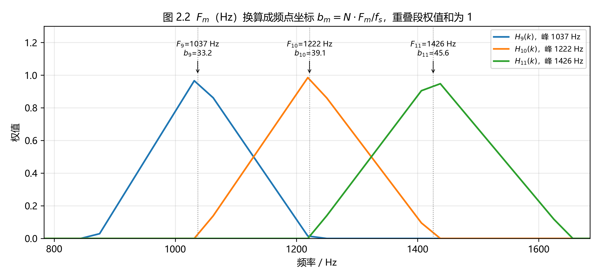
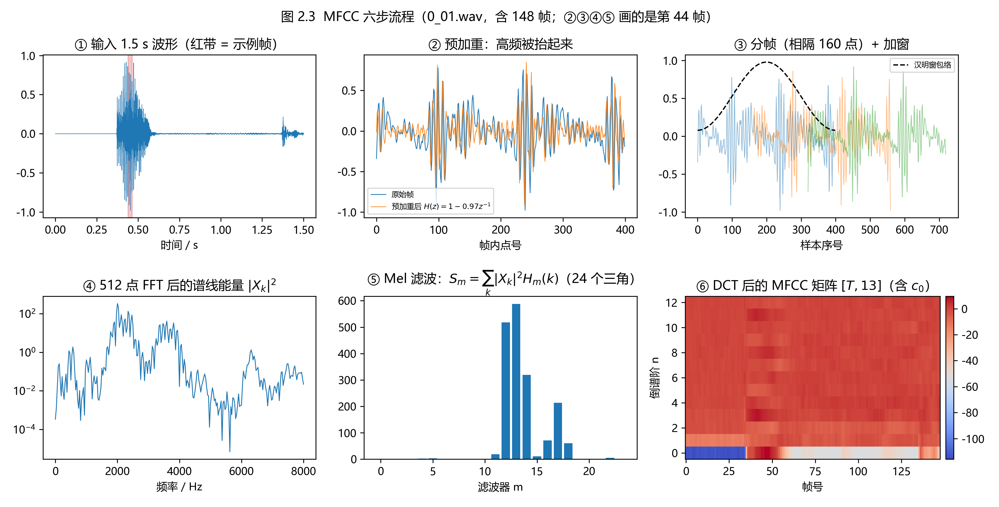
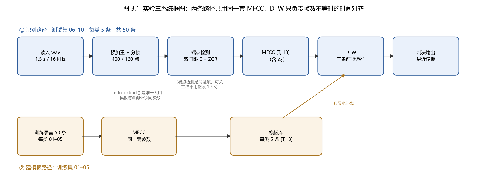
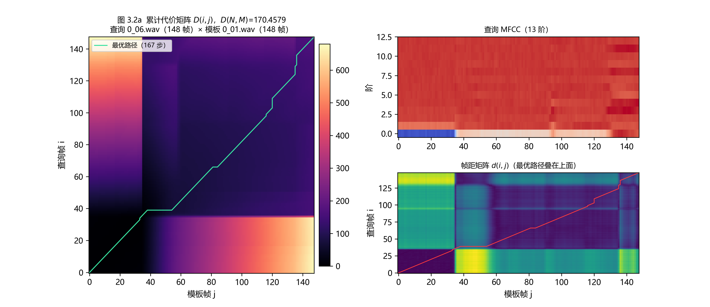
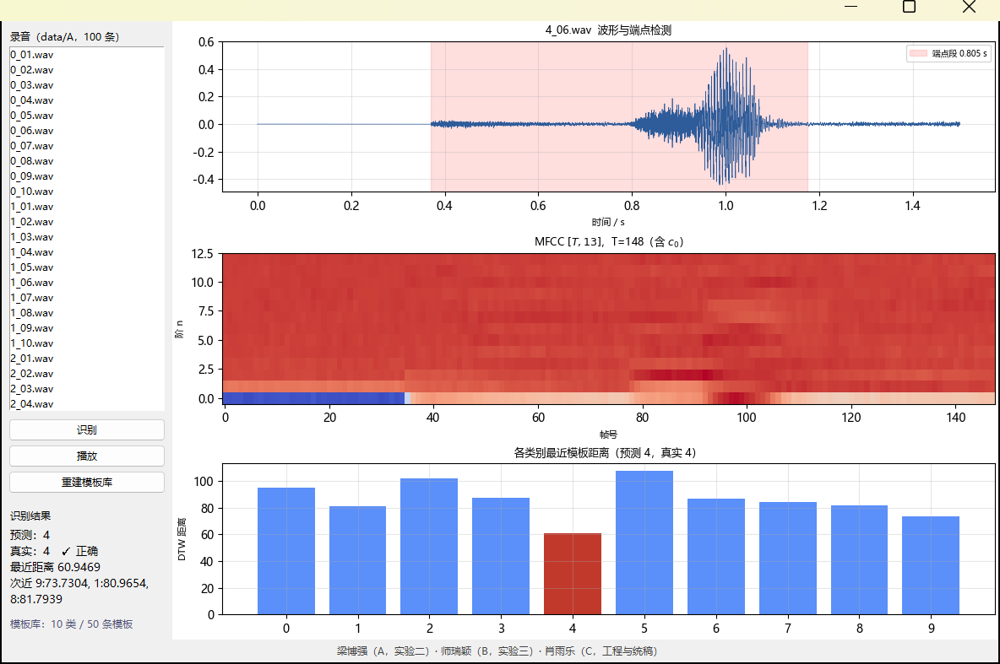

# 数字信号处理实验报告：频域特征提取与 DTW 孤立字识别

**实验二：频域特征（手写基 2 FFT 与 MFCC）　实验三：基于 DTW 的孤立字识别**

**数据**　`data/A`，10 个数字（0–9）× 10 条录音，16 kHz / 单声道 / 16 bit PCM / 1.5 s，单一说话人。

**代码**　仓库 `dsp-lab`，`dsp/` 共 8 个模块、`scripts/` 5 个脚本，全部自写，无第三方语音或 DTW 库。

**分工**　梁博强（A）：实验二 FFT、分帧加窗、MFCC；师瑞颖（B）：实验三 DTW、模板库、识别脚本；肖雨乐（C）：端点检测、界面、消融与统稿。

## 摘要

本报告完成两个实验：实验二用纯 Python 自写基 2 FFT 与 Mel 频率倒谱系数（MFCC）提取器，把 1.5 s 语音变成 148 帧 × 13 维的特征序列；实验三在此特征上用动态时间规整（DTW）做 50 条测试录音的孤立字识别。全部算法按讲义第 8–14 页的公式实现：FFT 采用补零、位倒序、蝶形三级结构，与 `numpy.fft` 的最大误差为 5.86×10⁻¹⁴（五个对拍用例里最大的一个，见表 2）；Mel 滤波器组用 24 个三角滤波器，在首个中心频率（74.4 Hz）与末个中心频率（7199.6 Hz）之间逐频点权重和为 1（两侧是过渡区）；DTW 只允许三条前驱、越界取 +∞、归一化因子取特征维数 13。识别主结果为 **40/50 = 0.800**，模板数从 1 增到 5 时识别率由 0.600 单调升到 0.800，倒谱均值归一化（CMN）把结果抬到 0.820，端点检测在不损失识别率的前提下把判决时间从 28.4 s 压到 7.5 s。实验二的窗函数与预加重消融全部落在 ±1 条样本内，说明在这套数据上它们不是瓶颈；瓶颈在模板数量与个别易混类别。

## 1 任务与数据

### 1.1 任务分解

实验二要求"自己写"整条频域特征链：预加重 → 分帧加窗 → 512 点 FFT → 功率谱 → Mel 三角滤波器组 → 离散余弦变换（DCT）得到 MFCC，并解释滤波器组与 Mel 频率刻度。实验三要求把 MFCC 序列送进 DTW，与模板库逐条比对，输出识别率与混淆矩阵。两个实验共用同一套特征参数，因此实现上被组织成一个包 `dsp/`（特征）与一组脚本 `scripts/`（实验）。

### 1.2 数据与划分

| 项目 | 设置 | 说明 |
| --- | --- | --- |
| 录音总数 | 100 条 | 数字 `0`–`9` 各 10 条，文件名 `{数字}_{序号}.wav` |
| 采样率 / 位深 / 时长 | 16 kHz / 16 bit / 1.5 s | 单声道，24000 个样本 |
| 训练集 | 每类 `01`–`05`，共 50 条 | 只用来建模板库 |
| 测试集 | 每类 `06`–`10`，共 50 条 | 只用来算识别率，训练与测试不重叠 |
| 前导静音 | 前约 5600 个样本恰为 0.0 | 数字静音约 0.35 s，端点检测必须挡住它 |

（表 1　数据与划分）

需要强调第 5 行：录音开头是数字静音而不是背景噪声，样本值精确等于 `0.0`。这既让端点检测容易（静音段能量为 0），也埋了一个坑——见 §3.2。

### 1.3 实现与复现

一条命令复现全部数字与图：

```
python -m scripts.run_all
```

它会依次跑自测（FFT 对拍、MFCC 形状、DTW 手算表）、实验二消融与三张图、实验三识别与消融、实验三两张图，产物落在 `report/evidence/`（自测文本）、`report/tables/`（csv）、`report/fig/`（图）。报告里每个数字与文件的对应关系写在 `report/tables/traceability.csv`。

## 2 实验二：手写基 2 FFT 与 MFCC

### 2.1 基 2 FFT

自写 `dsp/fft_radix2.py`，流程是教科书式的三步：不足 2^L 点补零、按位倒序重排、逐级蝶形。第 L 级把序列拆成 `size = 2^L` 的块，前半与后半分别乘旋转因子 `W_size^k = exp(−j2πk/size)` 后和差，即

X[k] = E[k] + W^k O[k]，　X[k + size/2] = E[k] − W^k O[k]

同一段代码对 `[N]` 与 `[T, N]` 两种形状都成立（把帧维当作批处理），因此 148 帧 × 512 点一次算完。

正确性用 `numpy.fft` 对拍，判据是最大绝对误差 < 1×10⁻¹⁰。五个用例的实测值全部落在 10⁻¹⁴ 量级：

| 用例 | 输入形状 | 最大误差 |
| --- | --- | --- |
| 实随机序列 | [512] | 2.28×10⁻¹⁴ |
| 单频 440 Hz 1 s（截 400 点） | [512] | 4.02×10⁻¹⁴ |
| 直流全 1 | [512] | 5.86×10⁻¹⁴ |
| 复数随机序列 | [512] | 3.97×10⁻¹⁴ |
| 真实录音的全部帧（批量） | [148, 512] | 7.94×10⁻¹⁵ |

（表 2　FFT 与 `numpy.fft` 的对拍；全部五个用例由 `python -m scripts.selftest` 打印并存档于 `report/evidence/exp2_fft_selftest.txt`，报告里引用的「最大误差」一律取这五行里的最大值 5.86×10⁻¹⁴）

实现对拍时踩到过一个真实的 bug：蝶形里 `even = blk[..., :half]`、`odd = blk[..., half:] * tw` 拿到的是视图，先写回 `blk[..., :half] = even + odd` 之后 `even` 已被改写，第二支 `even − odd` 就错了，误差高达 4.1×10¹。加上 `.copy()` 后误差降到 10⁻¹⁴ 量级。这条经验说明：**对拍必须在真实形状上跑，且误差要报到 10⁻¹⁰ 以下才算过**——只看"图看起来像频谱"是发现不了这个 bug 的。

### 2.2 预加重、分帧与加窗

预加重按 H(z) = 1 − 0.97 z⁻¹ 提升高频，补偿语音发声时声门脉冲带来的 −6 dB/oct 谱倾斜。分帧取帧长 25 ms（400 点）、帧移 10 ms（160 点），1.5 s 共 24000 点，帧数为

T = (24000 − 400) / 160 取整 + 1 = 148

与实测 `num_frames(24000, 400, 160) = 148` 一致。窗口用汉明窗 w[n] = 0.54 − 0.46 cos(2πn/(N−1))，400 点汉明窗的求和为 215.540，用作能量归一化的基准。

帧数 148 是本报告里出现次数最多的数字，报告里所有 `[T, 13]` 的 T 都指它。

### 2.3 Mel 三角滤波器组

Mel 刻度用讲义第 10 页的公式：

Mel(f) = 2595 · lg(1 + f/700)，　F⁻¹_Mel(b) = 700 · (e^{b/1125} − 1)

这里分母是 **1125**（不是常见的 1127），报告与代码统一取 1125，以保证与讲义一致。在 0–8000 Hz 之间等分 Mel 轴，取 24 个三角滤波器，第 m 个的中心频率 f(m) 换算成**离散频点序号**

f(m) = (N / f_s) · F⁻¹_Mel( Mel(f_low) + m · (Mel(f_high) − Mel(f_low)) / (M + 1) )

其中 N = 512 是 FFT 点数、f_s = 16000 Hz。为免把赫兹与下标混为一谈，本文记第 m 个滤波器的**物理中心频率**为 `F_m`（单位 Hz）、它在 512 点频谱上的**连续频点坐标**为 `b_m = (N / f_s) · F_m`——上面的 f(m) 就是 b_m，是"第几号频点"而不是赫兹。这一步是最容易做错的地方：错成"把 F_m 当 Hz 直接索引"时程序不会报错，三角形状依然整齐、S(i,m) 依然全正、`[T, 13]` 依然是 13 维，只有识别率会悄悄降低。为此专门画了两张图把这件事画出来。

![图 2.1　24 个 Mel 三角滤波器（M = 24，N = 512，f_s = 16000 Hz，f ∈ [0, 8000] Hz）；红色虚线为逐频点权重和 Σ_m H_m(k)（右轴）](fig/fig2_1_melbank.png)

图 2.1 里可以看到两条与讲义要求一致的性质：①滤波器在低频窄、高频宽，这是 Mel 刻度的直接结果；②红色的逐频点权重和**只在首个中心频率（74.4 Hz）到末个中心频率（7199.6 Hz）之间等于 1**，两侧各是一段过渡区——0 → 74.4 Hz 是左过渡区，7199.6 → 8000 Hz 是右过渡区，不是"只有 k = 0 与 k = 256 两个点掉到 0"。实测 `filterbank.sum(axis=0)`（24 × 257 的三角组）：k = 0 为 0，k = 1、k = 2 分别为 0.420、0.840，**k = 3…230 严格等于 1（共 228 个频点）**，k = 231…256 由 1 单调降到 0（末三角外沿被钉在 Nyquist，见 §2.3 脚注）。之所以内部恒为 1，是因为相邻两个三角在重叠段一升一降、斜率相反，两者之和恰好抵消。



图 2.2 取第 9、10、11 号滤波器。它们的物理中心频率 `F_m` 分别是 1037 Hz、1222 Hz、1426 Hz，换算成频点坐标 `b_m = (N / f_s) · F_m` 是 33.2、39.1、45.6——**带小数**。这直接说明了 b_m 的含义：它是连续的频点坐标，落在两个整数频点之间是正常的；三角最终只在整数频点上采样，所以离散峰值可能是 0.94 或 0.97 而不是恰好 1.0，但"相邻三角在共同重叠段上权重和为 1"这条恒等式仍然精确成立（图 2.1 的红线）。图 2.2 同时标了物理频率轴（下轴）与频点换算关系（箭头标注），两个量不要混用。

### 2.4 DCT 与 MFCC

对 24 个 Mel 能量取对数后做 DCT-II，按讲义取

mfcc(i, n) = √(2/M) · Σ_{m=1}^{M} ln S(i, m) · cos[π n (2m − 1) / (2M)]，　n = 0, 1, …, 12

得到 13 维（**含 c0**）。c0 正比于该帧对数能量的总和，携带"这一帧有多响"，对孤立字识别是有用的信息，因此不丢。图 2.3 把六步串起来：



六格依次是：①整条波形与示例帧位置；②预加重前后对比，高频分量被明显抬起；③相邻三帧加窗后的样子（虚线是汉明窗包络）；④该帧的 512 点功率谱 |X_k|²，对数纵轴；⑤该帧 24 个 Mel 通道能量，能量集中在 12–13 号通道；⑥整条录音 148 帧的 MFCC 热图，横轴帧号、纵轴倒谱阶 n。第 ⑥ 格下方那条蓝带是 c0，前 35 帧（静音段）明显低于语音段——这既是 c0 有用的证据，也是 §3.2 端点检测要挡住的区域。

### 2.5 消融：窗函数与预加重

单看 MFCC 数值大小无法判断"窗选得对不对"，因为不同窗口下特征尺度本来就不同。所以消融判据取**下游识别率**：固定其余参数，只换窗口或预加重系数，重跑整条识别流水线。结果如下。

| 窗口 | 预加重系数 | 识别率 | 说明 |
| --- | --- | --- | --- |
| 矩形窗 | 0.97 | 0.800 | 40/50 |
| 矩形窗 | 0.00 | 0.780 | 39/50 |
| 汉明窗 | 0.97 | **0.800** | 主口径，40/50 |
| 汉明窗 | 0.00 | 0.800 | 40/50 |
| 汉宁窗 | 0.97 | 0.780 | 39/50 |
| 汉宁窗 | 0.00 | 0.780 | 39/50 |

（表 3　三窗 × 预加重的识别率消融，其余参数固定为 24 Mel / 13 维 / 5 条模板 / 整段输入）

六格结果全部落在 0.780–0.800，跨度只有 1 条样本（2 个百分点）。结论要照实写：**在这套数据上，窗函数与预加重不是识别率的瓶颈**。原因不难理解——录音是数字静音 + 单人清晰发音，谱泄漏本来就小；预加重的作用更多体现在谱形状而非可分性上。这不代表选窗不重要，而是说明要提升这个任务，方向应该放在模板数量、端点质量与类别可分性上（见 §3.5、§4）。主口径仍取讲义推荐的汉明窗 + 0.97 预加重。

## 3 实验三：基于 DTW 的孤立字识别

### 3.1 系统框图



上图把两条路径画在一起：下排是建模板（训练 50 条 → MFCC → 模板库，每类 5 条），上排是识别（测试 50 条 → 预加重分帧 → 端点检测 → MFCC → DTW → 判决）。两条路径共用同一个入口 `mfcc.extract()` 与同一套参数，这是比较的前提：模板与查询的特征只要参数不一致，DTW 距离就没有可比性。端点检测标成虚线框加注"消融项，可关"，是因为主结果用整段 1.5 s，端点段只作为对照（§3.5）。

### 3.2 端点检测

按讲义第 12 页的框图，端点检测放在分帧之后、特征之前。实现用双门限 + 过零率（ZCR）：

1. 去直流：每帧减掉整条录音的均值；
2. 逐帧能量 E(i)（矩形窗，不加重叠）与过零率 ZCR(i)；
3. 门限取相对本句**峰值能量**的比例：高门限 0.002、低门限 0.0007，即 10·lg(0.002) ≈ −27 dB、10·lg(0.0007) ≈ −31.5 dB（能量是平方幅度，所以用 10 而不是 20 来换算）；
4. 判决规则：`voiced = (E ≥ 高门限) 或 (E ≥ 低门限 且 ZCR ≥ 60 百分位)`，即"够响"或"够轻但过零率高（清音）"；
5. 取第一个语音帧的起点到最后一段语音帧的终点，短于 100 ms 就向两侧补长。

这里踩过一个真问题：录音的「静音」并不是精确的 0，而是 **±1 LSB 的量化残差**（幅值 3.0518×10⁻⁵）。`0_01.wav` 前 0.35 s 的 5600 个样本里有 **1273 个非零**，占 **22.73%**，100 条录音的这个比例完全相同。由此静音帧的过零率实测约 **0.20**，反而**高于**全句 ZCR 的 60 百分位（`0_01` 为 0.161）——所以只靠 ZCR 判「有没有语音」会把整条录音判成语音，ZCR 判据**必须与低能量门限绑定**使用：只有「能量够低」并且「过零率偏高」才当清音接纳。

另外顺手核过一件事：100 条录音里 `numpy.signbit()` 命中「数值为 0」的样本数是 **0**（`-0.0` 并不存在），真正要注意的是上面这条 ±1 LSB 残差。

门限怎么定？不靠感觉，做一次扫描：固定低门限 = **高门限 × 0.35**（与 `dsp/endpoint.py` 的 `LOW_HIGH_RATIO` 一致），扫 6 档，统计 100 条录音的段长中位数。

| 高门限（占峰值能量） | 段长中位数 | 备注 |
| --- | --- | --- |
| 0.001 | 1.000 s | 太松，把前后杂音吞进来 |
| 0.002 | **0.665 s** | 选定；p10 = 0.285 s，p90 = 1.126 s |
| 0.003 | 0.455 s | |
| 0.005 | 0.410 s | |
| 0.010 | 0.355 s | 开始砍掉字头 |
| 0.020 | 0.305 s | 只剩响核 |

（表 4　端点门限扫描：100 条录音的端点段长中位数。低门限一律取 `high × 0.35`，与 `endpoint.detect()` 的默认口径（0.002 / 0.0007）同条件；数据由 `python -m scripts.exp3_recognize --all` 写入 `report/tables/exp3_endpoint_sweep.csv`）

按音节粗估的中位发音时长约 0.600 s（本仓没有人工端点标注，这个值只用于选档），0.002 对应的 0.665 s 最接近，且分布没有长尾（p90 = 1.126 s 对应那条带第二个音的 `0_01`）。作为对照，−10 dB（能量比 0.1、幅度比 0.316）会把字砍到只剩响核，中位段长只有 0.245 s。选 0.002 的另一个好处是识别率总数不掉：见 §3.5 的端点段一行，总数仍是 40/50（逐条判决中有 12 条互换，见 §3.5③），但判决时间只有 7.5 s 而不是 28.4 s，因为 DTW 的序列长度从 148 帧降到几十帧。

### 3.3 DTW

DTW 严格按讲义第 13 页实现，四条硬口径：

1. **只有三条前驱**：(i−1, j)、(i−1, j−1)、(i, j−1)，没有第四条；
2. **初值** D(1,1) = d(1,1)，从 (2,2) 开始递推，即
   D(i,j) = d(i,j) + min{ D(i−1,j), D(i−1,j−1), D(i,j−1) }
3. **越界取 +∞**，不取 0。取 0 相当于给"凭空跳一格"免费，路径会贴边走；
4. **帧距归一化因子 K = 13**，即特征维数，不是帧数：
   d(i,j) = (1/K) · √( Σ_{k=1}^{K} (x_{ik} − y_{jk})² )

为了证明这三条规则确实落到了代码里，专门维护了一张 3×3 手算表（`report/evidence/exp3_dtw_handcalc.txt`），输入是两帧序列：a 的 3 帧 = [0.1, 0.2, 0.3]×13，b 的 3 帧 = [0.1, 0.2, 0.4]×13。

| | j=1 | j=2 | j=3 |
| --- | --- | --- | --- |
| **i=1** | 0 | 0.02774 | 0.11094 |
| **i=2** | 0.02774 | 0 | 0.05547 |
| **i=3** | 0.08321 | 0.02774 | **0.02774** |

（表 5　3×3 DTW 累计代价矩阵 D(i,j)，右下角即最终距离）

手算与代码逐格一致：d(1,2) = (1/13)·√13·0.1 = 0.02774，d(1,3) = (1/13)·√13·0.3 = 0.08321，最终 D(3,3) = 0.02774，最优路径是主对角线 (0,0)→(1,1)→(2,2)。另外两条边界行为也写进自测：空序列距离返回 `inf`；两帧相差 1.0 的单帧距离为 (1/13)·√13 = 0.27735。



图 3.2 用真实数据画了三个视角：左图是累计代价矩阵 D 叠上最优路径（166 步），路径先贴对角、中段走平台、末尾又回对角——平台段对应两句话的语速差异；右上是对应的查询 MFCC；右下是帧距矩阵 d(i,j) 叠同一条路径，可以看到路径刻意避开了亮黄色的高距离区（两条录音前导静音与语音的分界相差约 59 帧（帧 35 对帧 94），路径用 19 段水平步与 19 段垂直步（单段最长 6 步）吸收了这段错位）。

### 3.4 模板库与判决

模板库每类 5 条（训练集 `01`–`05`），存成 `out/templates/`（`.npy` 缓存，不入库，`templates.build()` 一条命令重建）。测试时对每条查询算它到每个类别 5 条模板的帧距，**取最小距离**作为该类的得分，得分最小的类即判决结果。用最小而不是平均：模板之间是同一类字的不同念法，能匹配上任何一条就够，平均会把一条好的与四条差的混在一起。

### 3.5 识别结果

50 条测试录音，各条件结果如下。

| 条件 | 输入 | 模板数 | normalize | 正确/50 | 准确率 |
| --- | --- | --- | --- | --- | --- |
| **主结果** | 整段 1.5 s | 5 | none | 40 | **0.800** |
| 模板数对照 | 整段 | 1 | none | 30 | 0.600 |
| 模板数对照 | 整段 | 3 | none | 37 | 0.740 |
| 归一化对照 | 整段 | 5 | cmn | 41 | 0.820 |
| 端点段对照 | 端点段 | 5 | none | 40 | 0.800 |

（表 6　识别率与消融。耗时来自 `report/tables/exp3_accuracy.csv` 的「耗时s」列（同一次运行，含 100 条录音的特征提取）：主结果 28.4 s，模板 1 条 8.0 s，模板 3 条 20.5 s，CMN 31.9 s，端点段 7.5 s；机器负载不同会有 ±50% 的波动）

三件事值得说：

**① 模板数是第一位的。** 每类 1 → 3 → 5 条模板，识别率 0.600 → 0.740 → 0.800，单调上升。这符合 DTW 的直觉：模板越多，覆盖的语速与发音变化越广；每加一条模板，判决就多一次"碰运气对上"的机会。也说明继续加模板大概率还能涨，但成本线性增长（5 条已需 28.4 s）。

**② CMN 再涨 1 条。** 倒谱均值归一化（每帧减掉整条序列的均值，`normalize="cmn"`）把 40/50 抬到 41/50。它去掉的是信道与录音增益造成的整体偏移，与实验一"段内逐维归一化把 0.400 抬到 0.760"是同一个道理。但主口径仍取 `none`：一是讲义与本次实验的设定就是"原始 MFCC 直接进 DTW"，二是 CMN 在只有 1 条样本差的情况下不足以推翻主口径，两个表都如实报出。

③ **端点段：识别率总数不变，但不是“零代价”。** 50 条里 **12 条判决变了**：由错变对 5 条（`1_09`、`1_10`、`6_07`、`8_08`、`8_10`），由对变错 5 条（`0_10`、`2_10`、`7_07`、`7_08`、`7_10`），仍是错但换成别的错类 2 条（`6_10`、`8_09`）。类 7 的召回从 5/5 掉到 2/5，类 1 从 3/5 升到 5/5，两者恰好抵消，所以总数仍是 40/50。要说明的是端点段把判决时间从 28.4 s 压到 7.5 s（约 3.8 倍），代价是类别间的得失被重新分配。

分类别看混淆矩阵：

| 类别 | 召回 | 误判去向 | 说明 |
| --- | --- | --- | --- |
| 0 | 5/5 = 1.00 | — | |
| 1 | 3/5 = 0.60 | 1→0（1 条）、1→6（1 条） | 误判分散在两个方向 |
| 2 | 4/5 = 0.80 | 2→3（1 条） | |
| 3 | 5/5 = 1.00 | — | |
| 4 | 4/5 = 0.80 | 4→5（1 条） | |
| 5 | 5/5 = 1.00 | — | |
| 6 | 2/5 = 0.40 | 6→2、6→3、6→5（各 1 条） | 最差类别，误判摊到三个类 |
| 7 | 5/5 = 1.00 | — | |
| 8 | 2/5 = 0.40 | 8→3（2 条）、8→2（1 条） | 最差类别，主要混进 3 |
| 9 | 5/5 = 1.00 | — | |

（表 7　各类召回与误判去向，行=真实类别）

10 个类里 **5 个满分（类 0、3、5、7、9）**，两个 0.40（类 6、类 8），全部 10 条错例都集中在 5 组相邻或近音数字上（1↔6、2↔3、4↔5、6↔2/3/5、8↔2/3）。**类 6 的召回 0.40 与实验一的结果完全一致**——实验一里 7 个分类器（DTW、逻辑回归、高斯朴素贝叶斯、KNN、随机森林、SVM、决策树）在类 6 上的召回全部是 0.40。两套完全不同的特征（实验一的 DTW 用整段 `[T,3]` 逐帧时域特征，16 维汇总量喂的是另外 6 个分类器；本实验用 13 维 MFCC）在同一类上给出同一个 0.40，说明这不是特征问题，而是这一类字本身在这位说话人的发音里就与相邻类高度混淆。这是本次实验最有价值的一条交叉证据。

### 3.6 识别界面



界面用 `tkinter` + matplotlib 的 TkAgg 后端 + `winsound`，不依赖任何 GUI 框架。左侧是 100 条录音列表与三个按钮（识别 / 播放 / 重建模板库），右侧三行图：波形（阴影是端点段，本例 0.805 s）、MFCC 热图、各类别最近模板距离条形图（预测类标红）。截图这一例是 `4_06.wav`：预测 4、真实 4、正确，最近距离 60.9469，次近是类 9（73.7304），可以看出判决并不勉强——最优类比次优类低 **12.78（约 17.3%）**（73.7304 − 60.9469 = 12.7835）。状态栏同时显示模板库"10 类 / 50 条模板"，保证界面里看到的就是脚本算出的模板。

## 4 讨论

### 4.1 与实验一的对比

实验一在同一批数据上做过整段 `[T,3]` 逐帧时域特征（ln 短时能量 / ln 短时平均幅度 / 过零率）的 DTW 识别，记录的最佳结果是 0.760（38/50）。要说明的是：**实验一那 6 个 scikit-learn 分类器吃的是 16 维汇总量（0.480–0.640），DTW 吃的是逐帧 3 维序列**，两者不能混为一谈。本实验 13 维 MFCC 的 DTW 是 0.800（40/50），**无斜率/带宽约束、不做任何归一化**；实验一的 0.760 是**带 band = 0.35 的 Sakoe–Chiba 约束带 + 段内逐维零均值单位方差归一化**的结果。口径不同，所以下面讲的是"关系"，不是"0.800 比 0.760 高 2 条"。

1. **实验一的 0.760 依赖"段内逐维零均值单位方差归一化"，且这一条在本仓可以复现**。用仓库里的实验一代码（`task1_w2/第一部分/接口冻结_1/speech_time_domain.py` 的 `time_domain_feature` + `DTWClassifier(band_ratio=0.35)`）在**整段 1.5 s 录音**上跑同一套 5 条模板，本文实测：`normalize=True` → **38/50 = 0.760**，`normalize=False` → **20/50 = 0.400**；把约束带放到 1.00，两种归一化下仍是 38/50 与 20/50，只是预测耗时 **15.90 s 升到 27.21 s**。也就是说**0.760 与 0.400 的差距完全由段内归一化决定，约束带只影响耗时**。注意别用 `task1_w2/第二部分/frame_sequences.pkl` 做这个对照——那份缓存是"端点段 + 已归一化"的数据，拿它跑只会得 0.400，是混淆变量。
2. **实验一的"16 维"是名不副实的（但只限于那条支线）**。`feature_extract.py:171-172` 对已经归一化过的序列再求均值与标准差，导致 dim0–dim5 跨 100 条录音的标准差恒为 0.000000，`time_domain_feature_table.csv` 里实际只有 10 维可变；而 `compare_7classifiers.py:70-72` 用的是 `时域特征汇总.csv`（`normalize=False`），那 16 维是全部可变的。所以不能说"16 维太多导致过拟合"，正确的说法是"这条支线有效维不足，而训练样本只有 50 条"。
3. **实验一的 0.540 不能当作"端点段更差"的证据**。0.540 在实验一的材料里同时对应三件事：高斯朴素贝叶斯在端点段输入上的结果、DTW 在端点段上的 27/50、以及单用过零率这一特征的准确率——引用时必须写明是哪一条。而实验一的端点实现确有严重缺陷：端点段中位只有 0.195 s（**69/100 条不足真实时长的一半、8/100 条反而被拉长**），而真实发音的中位时长约 0.600 s。也就是说那一列数字测的是"残缺片段"，不是"端点检测"。

带上这三条前提，本实验与实验一的关系才说得清：MFCC 在**不做任何归一化、也不加任何约束带**的情况下就到 0.800；实验一的时域特征在"段内归一化 + band 0.35"下是 0.760，去掉归一化只剩 0.400。也就是说 MFCC 的抗增益/抗信道能力来自它自身的构造（对数 Mel 能量 + DCT 去相关），不需要靠后处理归一化来补。至于 0.800 与 0.760 的差值，因为约束带与归一化都不同，本文不把它当作两种特征优劣的度量。

### 4.2 为什么主口径取 `normalize="none"`

C10 口径把 `none` 定为主结果。理由有三条：①本实验的 MFCC 含 c0，c0 携带帧能量，本身带有"绝对响度"信息，而 CMN 会把它连同信道偏移一起减掉；②主口径要能直接对照讲义公式，多一步归一化就多一处偏离；③实测差距只有 1 条样本（0.800 vs 0.820），在 50 条测试集的统计波动之内，不足以支撑"归一化更好"的强结论。因此两个口径都报，主口径保守取 `none`。

### 4.3 误差分析

10 条错例全部落在近音类之间，逐条列出（真实 → 预测）：

- 类 8 → 3（2 条）与类 6 → 3（1 条）：数字 3 与 8、6 的韵母部分相近，DTW 在整段对齐时更容易被韵母段主导；
- 类 6 → 2、类 6 → 5（各 1 条）：类 6 的三条错例分别摊到 2、3、5，没有单一方向，说明这个字本身就在多个类之间摇摆；
- 类 1 → 0、类 1 → 6（各 1 条）：两组在基频与时长上都接近，端点段一旦起点差一帧，DTW 会用一个平台段吸收掉差异，代价上升不明显；
- 类 2 → 3（1 条）与类 8 → 2（1 条）：2 与 3、8 与 2 都是韵母相近的对；
- 类 4 → 5（1 条）：唯一一条孤立错误，两字都是短促的高频段。

合计 10 条 = 50 条的 20%，与 40/50 的准确率一致。

从图 3.2 可以看出这类错误的机制：前导静音的结束点只要差几十帧，最优路径就会用一段水平或垂直段去吸收，而 DTW 对"插入/删除帧"只收一次帧距的代价，不会额外惩罚。这正是经典 DTW 的已知弱点，也是后续可以加斜率约束或 Itakura 平行四边形的理由（本实验按讲义要求未加）。

### 4.4 工程实现上的三条经验

1. **对拍要卡阈值**：FFT 的视图别名 bug 让当次对拍的最大误差一度到 4.1×10¹ 量级（这条是调试时的记录，未随仓库存档），但画出来的频谱"看起来仍然像频谱"。只有把"最大误差 < 1e-10"写进自测，bug 才会暴露。
2. **消融要选对判据**：MFCC 数值在不同参数下不可直接比较，只有下游识别率能回答"这个参数好不好"。
3. **静音段不是精确的 0**：它是 ±1 LSB 的量化残差（幅值 3.0518×10⁻⁵，前 0.35 s 里 22.73% 的样本非零），所以静音帧的过零率并不为 0，ZCR 判据必须与低能量门限绑定。

## 5 结论

1. 用纯 Python 实现了完整的频域特征链与 DTW，并与 `numpy.fft`、手算表逐点对拍，误差 10⁻¹⁴ 量级，满足 10⁻¹⁰ 的判据。
2. Mel 滤波器组的核心是"物理中心频率换算为频点坐标 `b_m = (N/f_s)·F_m`"与"相邻三角在共同重叠段上权重和为 1（首末中心频率之间成立，两侧是过渡区）"，两者都在图 2.1、图 2.2 上给出可视化证据。
3. 实验三主结果 40/50 = 0.800；模板数 1/3/5 对应 0.600/0.740/0.800；CMN 抬到 0.820；端点检测保持 0.800 而把时间从 28.4 s 缩短到 7.5 s。
4. 窗函数与预加重的消融全部落在 ±1 条样本内，说明它们不是本任务的瓶颈。
5. 类 6 的召回 0.40 与实验一 7 个分类器完全一致，交叉验证了"这一类字本身易混"的判断。
6. 与实验一记录的 0.760（依赖段内逐维归一化 + band = 0.35 约束带）相比，本实验 13 维 MFCC 在**不做归一化、不加约束带**的前提下即达 0.800；时域特征去掉段内归一化后在本仓复算为 20/50 = 0.400。因口径不同，只作定性对照，不把两者的直接差值当作特征优劣的度量。

## 6 局限与改进

1. **单一说话人、同一批录音**：训练与测试来自同一个人、同一次录制，0.800 不能外推到多人场景。跨人识别需要每类更多模板或说话人自适应。
2. **测试集只有 50 条**：1 条样本 = 2 个百分点，0.780/0.800/0.820 之间的差别都在统计噪声内，报告里已避免据此下强结论。
3. **DTW 无斜率约束、无窗**：允许任意多的水平/垂直段，对端点误差敏感（见 §4.3）。加 Itakura 平行四边形或斜率上限是直接的改进方向。
4. **端点检测只用能量 + ZCR**：对清音与鼻音的门限较粗；可换用谱熵或倒谱距离做判决，或直接对 DTW 做多候选端点（每条录音试 3 个端点候选，取代价最小）。
5. **模板库未做筛选**：5 条模板等权，可先用留一法剔除离群模板，再决定每类取几条。

## 7 参考文献

1. 课程讲义《数字信号处理》第 8–14 页（实验二、实验三指导书；本报告所有公式口径以它为准）。
2. L. R. Rabiner, B. H. Juang. Fundamentals of Speech Recognition. Prentice Hall, 1993.（MFCC 与 DTW 的经典处理）
3. S. B. Davis, P. Mermelstein. Comparison of parametric representations for monosyllabic word recognition in continuously spoken sentences. IEEE Trans. ASSP, 28(4): 357–366, 1980.（MFCC 原始文献）
4. H. Sakoe, S. Chiba. Dynamic programming algorithm optimization for spoken word recognition. IEEE Trans. ASSP, 26(1): 43–49, 1978.（DTW 的原始表述与斜率约束）
5. 本仓库 `docs/实验二三技术路线.md`、`report/tables/traceability.csv`（实现与数字的对应关系）。

## 附录 A　MATLAB ↔ Python 对照

讲义第 12 页的示例用 MATLAB 写，本次实验统一用 Python 实现（C01 口径）。两种语言的对应关系如下，方便按讲义核对。

| 环节 | 本实验的 Python 实现 | MATLAB 对照 |
| --- | --- | --- |
| 读 wav | `dsp.io_wav.read_wav()`（手写 RIFF 解析，不依赖 scipy） | `audioread('0_01.wav')` |
| 预加重 | `dsp.framing.preemph(x, 0.97)` | `x = filter([1 -0.97], 1, x)` |
| 分帧 | `dsp.framing.frames(x, 400, 160)` 返回 `[T, 400]` | `buffer` / `enframe` |
| 加窗 | `dsp.framing.window(400, "hamming")` | `hamming(400)` |
| FFT | `dsp.fft_radix2.fft(fr, 512)`（自写基 2） | `fft(fr, 512)` |
| 功率谱 | `dsp.mfcc.spectrum_energy(fr, 512)` | `abs(fft(x)).^2` |
| Mel 滤波器组 | `dsp.mfcc.mel_filterbank(24, 512, 16000)` | `melbankm`（第三方）或手写三角 |
| 取对数 + DCT | `dsp.mfcc.from_frames(...)` 内部 `ln` + 自写 DCT 矩阵 | `dct(log(S))` |
| DTW | `dsp.dtw.distance(a, b)`（三条前驱、1 基、越界 +inf） | 手写三重循环或 `dtw()`（第三方） |

（表 8　MATLAB 与 Python 的对应关系）

## 附录 B　复现清单与文件位置

| 内容 | 位置 |
| --- | --- |
| 特征与算法模块 | `dsp/io_wav.py`、`framing.py`、`fft_radix2.py`、`mfcc.py`、`endpoint.py`、`dtw.py`、`templates.py`、`app.py` |
| 实验脚本 | `scripts/selftest.py`、`exp2_ablation.py`、`exp3_recognize.py`、`exp3_figs.py`、`run_all.py` |
| 自测证据 | `report/evidence/exp2_fft_selftest.txt`、`exp2_mfcc_shape.txt`、`exp3_dtw_handcalc.txt`、`run_all.log` |
| 数据表 | `report/tables/exp2_ablation.csv`、`exp3_accuracy.csv`、`exp3_confusion.csv`、`exp3_predictions.csv`、`traceability.csv` |
| 图 | `report/fig/fig2_1_melbank.png`、`fig2_2_triangles.png`、`fig2_3_mfcc_flow.png`、`fig3_1_system.png`、`fig3_2_dtw_grid.png`、`app_main.png` |

复现命令见 §1.3：一条 `python -m scripts.run_all` 全跑（约 2 分钟），加 `--fast` 跳过消融，`python -m dsp.app` 起界面。
