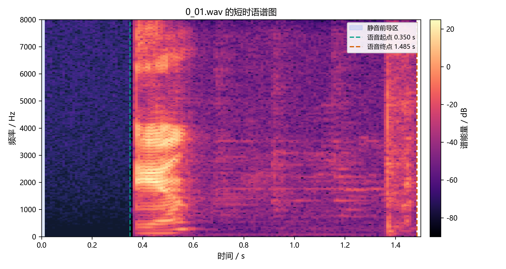
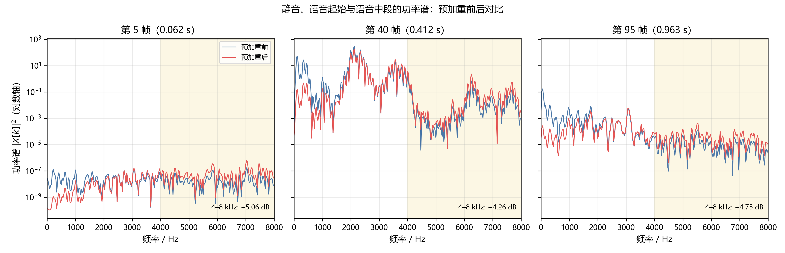
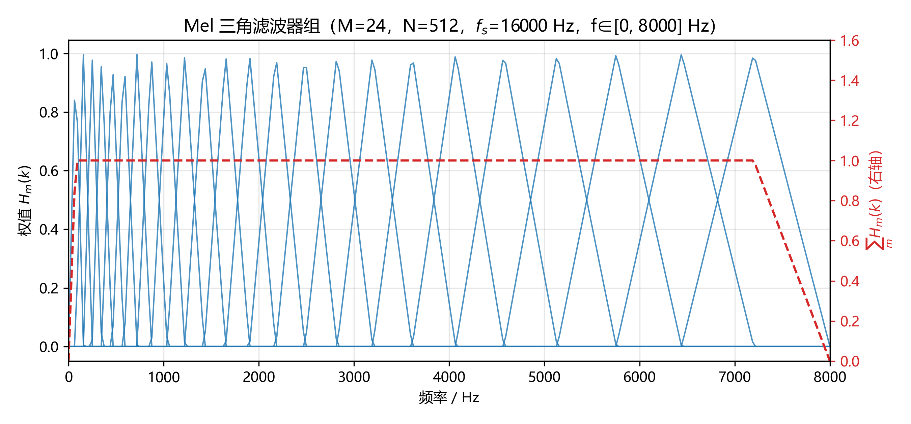
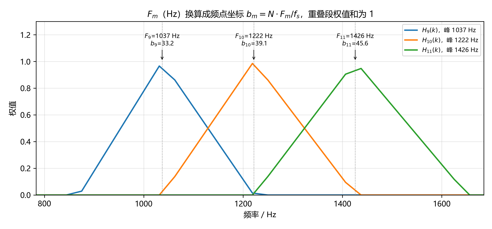
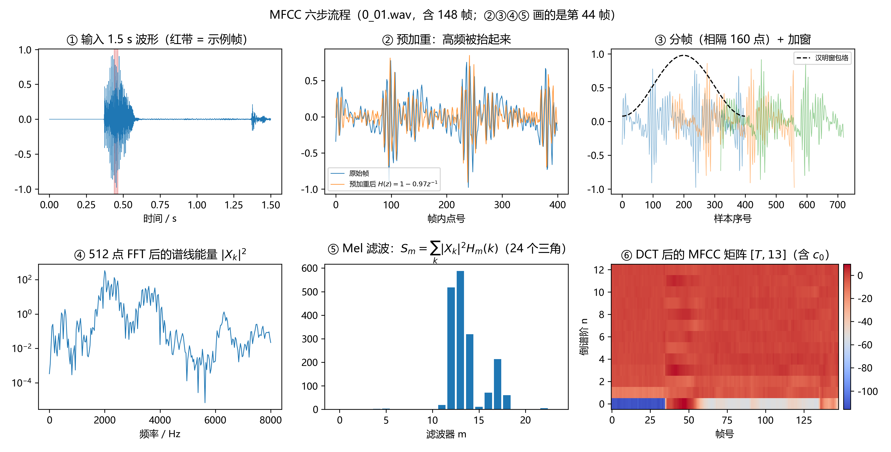
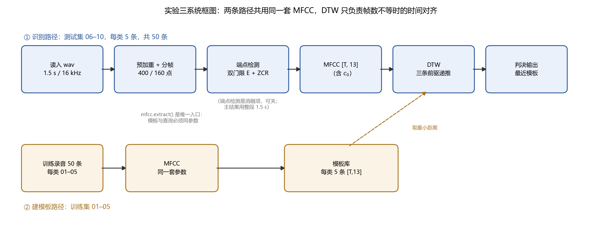
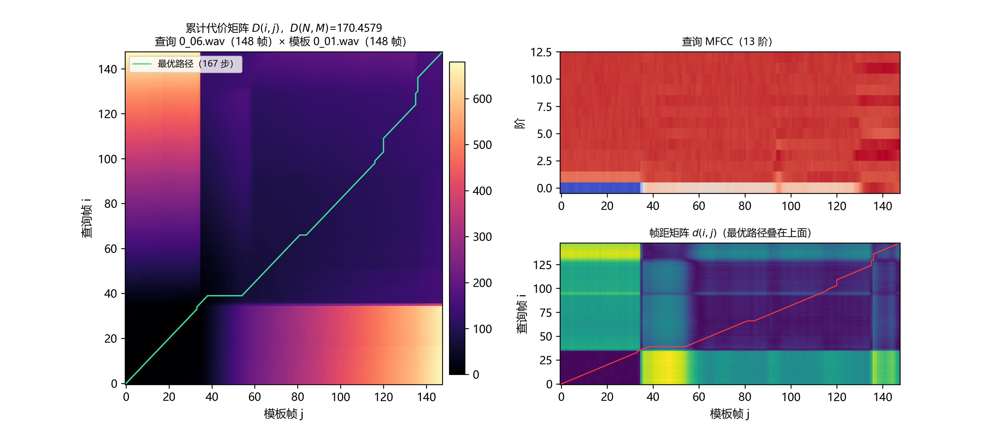
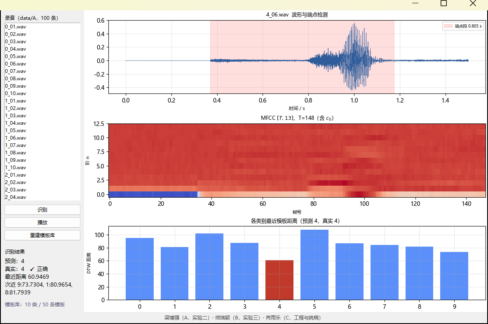

# 基于 MFCC 与 DTW 的孤立字识别：频域特征、端点段与鲁棒性的实验研究

梁博强　　师瑞颖　　肖雨乐

**摘要：**本文合并课程实验二与实验三，在不用第三方语音或 DTW 库的前提下自行实现孤立字识别系统。方法用预加重、分帧加窗与手写基 2 FFT 求谱线能量，经 24 个 Mel 三角滤波器与 DCT 取 13 维 MFCC，再用 DTW 三条前驱递推做模板匹配。数据为单一说话人 100 条录音，50 训练 / 50 测试。主结果 40/50 = 0.800；模板数 1/3/5 为 0.600/0.740/0.800；倒谱均值归一化升到 0.820；端点段同为 0.800 但 12/50 判决互换、耗时 12.1 → 2.5 s；Δ/ΔΔ 拼成 39 维掉到 0.720；噪声 20 dB 即 0.520，加 CMN 后增益三档恒 0.820。结论：误差主要来自端点取舍与类别混淆而非特征维数。

**关键词：**MFCC；Mel 滤波器组；动态时间规整；端点检测；频域特征；孤立字识别

## 一、引言

### 1.1 研究背景

孤立字识别是语音识别问题的最小可解形态：输入是一个数码（0–9）的一次发音，输出是它的类别，中间不需要语言模型，也不涉及连续语音的切分与解码。它规模小、边界清楚，却完整包含从波形到判决的每个环节——预处理、特征提取、时间规整、模板匹配与判决。实验二与实验三分别承担了这条链路的前半段（从波形到频域特征）与后半段（从特征序列到判决）；合并成一篇的理由是：分开写时「特征为什么这样取」与「识别率为什么是这个值」彼此不可见，合起来才能说清九个消融数字对应特征侧还是匹配侧。

课程有硬约束：不许调用 librosa、python_speech_features、fastdtw 一类第三方语音或 DTW 库，FFT 也必须自己用基 2 蝶形写出来。这条约束把系统的每一层摊开在实验者面前，也把「数字对不对」变成必须自证的问题——只能靠与 `numpy.fft` 对拍、靠 3×3 手算、靠加噪前后的信噪比标定来证明。本文因此把这类自证单独列节（3.7、3.8、6.6），附录 A 给出可一条命令重跑的复现清单。

### 1.2 相关工作

经典教科书把孤立字识别放在模板匹配框架下讨论：特征侧以倒谱系数为主流，匹配侧以 DTW 为主流[2]。Davis 与 Mermelstein 在 1980 年系统比较了多种参数化表示，指出 Mel 频率刻度的三角滤波器组加倒谱变换在单音节词识别上明显优于线性频谱与线性预测类参数[3]，这为本文取 24 个 Mel 三角、13 维倒谱系数提供依据。Sakoe 与 Chiba 在同期的动态规划工作把「两条不等长特征序列的对齐」化为三条前驱的递推[4]，并给出路径约束带来抑制过度弯折（Itakura 平行四边形是其变体）；本文的 DTW 严格按三条前驱递推，但未加约束带，这一点在 4.2 节说明、在 6.5 节作为局限讨论。

本课程实验一已在时域特征上用 7 个分类器做过对照，最好成绩落在 0.480–0.640 区间[5]，说明在只有 100 条录音、一位说话人的条件下，瓶颈不在分类器的容量，而在特征的可分性与时间对齐方式。本文因此不换分类器，把匹配器固定为 DTW，变量集中到特征形态、端点段与模板数量三处。

### 1.3 本文工作

本文工作可概括为三件事。第一，把实验二与实验三合并为一篇可独立阅读的论文：第二、三章交代数据与频域特征的实现，第四、五、六章交代匹配方法、九组实验结果与讨论；格式规范、表号映射与合稿由第三人负责，两章正文由另外两人分头执笔、再由三人交叉复核。第二，把散落在 csv 与 txt 里的数字整理成 9 张表、8 张图，用 `report/tables/traceability.csv` 做到「数字 → 出处文件 → 复现命令 → 论文表号」四段可追。第三，围绕主结果 40/50 = 0.800 做系统消融：模板数量、端点段、窗函数与预加重、频域变体、时域对照、噪声与增益共八组条件，其中端点段与 CMN 两组各带来 12/50 量级的判决变化，提示误差主要来自时间边界与能量项，而不是特征维数。

## 二、实验数据与实验平台

实验二与实验三共用同一批录音与特征参数，故数据口径在此一次说明。

### 2.1 语料与数据格式

语料为数字 0–9 的单字发音，每个数字 10 条共 100 条，文件名形如 `{数字}_{序号}.wav`，序号 01–10。录音由同一说话人在同一增益下采集，不含信道与说话人差异，识别难度集中在字间声学混淆上。

WAVE 文件由自写的 RIFF 解析器逐 chunk 读取（`dsp/io_wav.py:24-61`）：实验二要求各模块自行编程实现；且块长度字段为奇数时须补 1 字节对齐（`dsp/io_wav.py:51`），漏掉会让后续块整体错位。16 bit PCM 按 2¹⁵ 归一化到 [−1, 1)（`dsp/io_wav.py:77`），量化间隔 3.0518×10⁻⁵。

| 项目 | 实测结果 | 说明 |
| --- | --- | --- |
| 录音条数 | 100 条 | 0–9 各 10 条，序号 01–10 |
| 采样率 | 16 kHz | 100 条一致 |
| 声道数 | 单声道 | 100 条一致 |
| 量化格式 | 16 bit PCM（格式 1） | 按 2¹⁵ 归一化，量化间隔 3.0518×10⁻⁵ |
| 时长与样本数 | 1.5 s / 24000 样本 | 与帧移共同决定 T = 148 |
| 说话人 | 单一说话人 | 同一人、同一增益 |
| 前导静音段 | 前 5600 个样本 | 其中 1273 个为 ±1 LSB 残差（3.0518×10⁻⁵，占 22.73%），其余 4327 个恰为 0 |

（表 1　语料与格式实测。逐条统计由 `dsp/io_wav.py:97-102` 打印，前导静音口径见 `dsp/endpoint.py:28-39`。）

<!-- widths: 3.4,4.2,8.4 -->
表 1　语料与格式

| 项目 | 取值 | 说明 |
|---|---|---|
| 语料总量 | 100 条 | 10 类 × 每类 10 条，命名 {0…9}_{01…10}.wav |
| 说话人 | 1 人 | 单一说话人朗读 0–9 十个数字，无跨人条件 |
| 采样格式 | 16 kHz / 16 bit / 单声道 | 每条 48044 字节，1.500 s = 24000 点 |
| 训练集 | 50 条 | 序号 _01–_05，每类 5 条 |
| 测试集 | 50 条 | 序号 _06–_10，每类 5 条 |
| 分帧 | 148 帧 | 帧长 400 点（25 ms）、帧移 160 点（10 ms） |
| 特征 | 13 维 MFCC | 24 个 Mel 三角、FFT 512 点、汉明窗、预加重 0.97 |

注：每条录音含约 0.35 s 前导静音（样本下标 0…5599）；训练/测试按录制序号划分，两组不重叠，每类 5 训练 + 5 测试。帧数按 floor((N−400)/160)+1 计算，N = 24000 点。

### 2.2 数据质量与端点段观察

表 1 末行最易被忽略：录音开头是**数字静音**而非模拟静音，却并不精确等于 0。前 5600 个样本中 1273 个取值为 ±3.0518×10⁻⁵，即 ±1 个最低有效位（LSB）的量化残差，其余 4327 个恰为 0.0，100 条录音完全一致。

这一事实对端点检测有直接后果：静音帧能量极低，过零率却不为 0——量化残差逐点跳变，使静音帧的过零率反高于全句过零率的 60 百分位判据。若只按过零率判「有无语音」，整条录音都会被判成语音，故过零率须与低能量门限绑定，只有「能量够低且过零率偏高」的帧才按清音接纳（`dsp/endpoint.py:82`，残差说明见 `:28-39`）。能量门限取双门限：高门限为峰值能量的 0.002（−27 dB），低门限为其 0.35 倍即 0.0007（−31.5 dB）；高门限定起止帧，低门限向两侧延伸，过零率作补充（`dsp/endpoint.py:47-108`）。端点段以样本下标的半开区间返回，`0_01.wav` 得 [5600, 23760)，即 0.350 s 至 1.485 s、长 1.135 s；100 条录音的段长中位数 0.665 s，p10 为 0.285 s，p90 为 1.126 s（`report/tables/exp3_endpoint_sweep.csv`）。

图 1 落在谱图上：前 0.350 s 整段 0–8000 Hz 都低于 −80 dB，与 ±1 LSB 残差的量级相符；0.40–0.60 s 在 1.5–4 kHz 出现高亮区，横向细纹为谐波；0.60 s 后能量下降、亮区移向低频，但 4–8 kHz 仍有可辨横纹，说明高频分量只是弱于低频而非不存在。



图 1　0_01.wav 的短时语谱图（148 帧 × 257 频点，色标 10·lg|X[k]|²，−90…+25 dB）；蓝色阴影为前导静音区 0–0.350 s，绿、红虚线为语音起点 0.350 s 与终点 1.485 s

端点段只作对照口径，主结果一律用整段 1.5 s：整段口径不引入端点判据自身的误差，便于把特征提取与端点检测的贡献分开。

### 2.3 训练/测试划分

数据按文件序号划分而非随机抽样：序号 01–05 的 50 条为训练集，只用于建立模板库；序号 06–10 的 50 条为测试集，只用于计算识别率（`dsp/templates.py:20-21`）。两个集合逐条不重叠，每类各 5 条。

固定划分使结果可逐条复现与追责：识别率的任何变动都能定位到具体录音。代价是测试集只有 50 条，1 条即 2 个百分点，故 0.780、0.800、0.820 的差异都落在统计噪声内，本文不据此判断方法优劣。另有一条硬性约束：模板与查询须由同一次参数设置提取（`dsp/templates.py:52-55`），参数不一致则动态时间规整的距离失去可比性。

### 2.4 实验环境与可复现性

实现语言为 Python 3.12（实测 3.12.14）。数值计算只依赖 numpy 2.3.5，且仅用于数组运算与对拍基准，`numpy.fft` 与 `scipy.fft` 都不参与特征计算；scipy 1.16.3、matplotlib 3.10.6 分别用于参考比对与绘图，经 `dsp/env.py:35-43` 的 `add_pylibs()` 从归档目录挂载（`dsp/env.py:21-25`），版本由 `requirements.txt` 固定。环境不含第三方语音处理或动态时间规整库。

全部数字与图由一条命令复现：`python -m scripts.run_all`。该命令串起 8 个步骤，全量耗时 477.2 s（约 8 分钟），`--fast` 档 47.7 s（约 1 分钟）（`docs/第六周_工作汇总.md`）；步骤失败时不写出溯源表，以免把未生成的产物登记成「有出处」。正文每个数字与文件的对应关系记录在 `report/tables/traceability.csv`（19 行）。

## 三、频域特征提取方法

频域特征链按讲义 p8–p11 的顺序实现为六步：预加重、分帧加窗、512 点 FFT、谱线能量、Mel 三角滤波、取对数与离散余弦变换。统一参数为采样率 16 kHz、帧长 25 ms（400 点）、帧移 10 ms（160 点）、FFT 点数 512、滤波器个数 24、倒谱阶数 13、预加重系数 0.97。

### 3.1 预加重

预加重用一阶高通 H(z) = 1 − 0.97z⁻¹，时域写作 y[n] = x[n] − 0.97x[n − 1]、首点取 y[0] = x[0]（`dsp/framing.py:38-46`），用以补偿声门脉冲激励造成的约 −6 dB/oct 谱倾斜，使高低频段在后续 Mel 滤波时处于可比量级。实现上预加重对整条信号一次完成、先于分帧（`dsp/framing.py:66-67`）：y[n] 只依赖相邻两点，跨帧边界仍连续，两种顺序结果相同，而整条处理少一次边界判断。

图 2 给出定量读数：取同一条录音的第 5 帧（0.062 s，静音）、第 40 帧（0.412 s，语音起始）、第 95 帧（0.963 s，语音中段），比较 4–8 kHz 频段总能量，第 40 帧被抬高 **+4.26 dB**、第 95 帧被抬高 **+4.75 dB**，同时 1–4 kHz 的共振峰被压低（`report/evidence/exp2_freq_figs.txt`）。第 5 帧的 4–8 kHz 也显示 +5.06 dB，但该帧谱峰只有 1.71×10⁻⁷、整帧谱形平坦，属量化残差的谱泄漏，**不能作为预加重有效的证据**。



图 2　预加重前后的功率谱：三格为第 5/40/95 帧，纵轴 |X[k]|²（对数轴），蓝线为预加重前、红线为预加重后，黄影为 4–8 kHz 频段，格内数字为该频段总能量的变化

### 3.2 分帧与加窗

语音是短时平稳信号，分帧把它切成 25 ms 的短段。帧长 25 ms 即 400 点，帧移 10 ms 即 160 点；1.5 s 共 24000 点，帧数为

T = floor((24000 − 400)/160) + 1 = 148

与 `num_frames(24000, 400, 160) = 148` 一致（`dsp/framing.py:49-53`，`report/evidence/exp2_fft_selftest.txt`）。分帧一律左对齐，尾部不足一帧的样本直接丢弃而不补零，故 23999 点同样得 148 帧，200 点只得 1 帧（短于一帧的输入先补零成一帧，`dsp/framing.py:63-65`）。

加窗用汉明窗 w[n] = 0.54 − 0.46cos(2πn/(N − 1))（`dsp/framing.py:31-32`），压低帧两端突变以抑制谱泄漏。400 点汉明窗求和为 **215.540**，首点 0.0800、中点 1.0000；同长度矩形窗求和 400.000、汉宁窗 199.500（`report/evidence/exp2_fft_selftest.txt`）。

窗与预加重是否影响可分性以识别率判定：固定其余参数，三窗 × 预加重两档共 6 个条件，识别率落在 0.780–0.800，跨度仅 1 条样本（`report/tables/exp2_ablation.csv`）。可见在这套「数字静音 + 单人清晰发音」的数据上，窗形与预加重不是瓶颈，提升方向在模板数量与类别可分性而非前端加窗。

### 3.3 手写基 2 FFT 与谱线能量

FFT 按讲义 p10 要求自行实现（`dsp/fft_radix2.py:38-76`），不调用 `numpy.fft` 或 `scipy.fft`，numpy 只用于数组运算。实现分三步：长度不足 2^L 时补零（`next_pow2`，`dsp/fft_radix2.py:20-25`；取 2^L 见 `:57-58`，补零见 `:60-61`）；按位倒序重排下标（`dsp/fft_radix2.py:28-35`、`:62`）；逐级蝶形，第 L 级把序列拆成 size = 2^L 的块，旋转因子 W_size^k = e^(−j2πk/size)，前半与后半乘因子后作和、差写回（`dsp/fft_radix2.py:64-74`）：

X_k = E_k + W_k · O_k，X_{k+size/2} = E_k − W_k · O_k

同一段代码对 `[N]` 与 `[T, N]` 两种形状都成立：一维输入先升成二维批处理（`dsp/fft_radix2.py:46-49`），于是 148 帧 × 512 点一次算完，无需外层循环；频谱只留非负频率的 N/2 + 1 = 257 个频点（`dsp/fft_radix2.py:79-83`）。

一处细节：蝶形上下两支不能直接对视图运算。若写成 `even = blk[..., :half]`、`odd = blk[..., half:] * tw` 而不拷贝，写回 `even + odd` 后 `even` 已被就地改写，第二支 `even − odd` 必然出错，实测误差升到 10¹ 量级（实随机序列 6.1×10¹、复随机序列 8.8×10¹，`report/evidence/exp2_fft_viewbug.txt`）；加 `.copy()` 后降到 10⁻¹⁴ 量级（`dsp/fft_radix2.py:70-71`）。故对拍须在真实形状上做，误差报到 10⁻¹⁰ 以下才算通过。

正确性以 `numpy.fft` 为基准对拍，判据为最大绝对误差 < 1×10⁻¹⁰，五例见表 2。

| 用例 | 输入形状 | 最大绝对误差 |
| --- | --- | --- |
| 实随机序列 | [512] | 2.28×10⁻¹⁴ |
| 单频 440 Hz 1 s（截 400 点） | [512] | 4.02×10⁻¹⁴ |
| 直流全 1 | [512] | 5.86×10⁻¹⁴ |
| 复数随机序列 | [512] | 3.97×10⁻¹⁴ |
| 真实录音的全部帧 | [148, 512] | 7.94×10⁻¹⁵ |

（表 2　手写基 2 FFT 与 `numpy.fft` 的对拍，判据为最大绝对误差 < 1×10⁻¹⁰；五例由 `python -m scripts.selftest` 打印并归档于 `report/evidence/exp2_fft_selftest.txt`。）

第 4 步取谱线能量 E(i,k) = |X_i(k)|²（`dsp/mfcc.py:94-97`），逐帧输出 `[148, 257]` 实矩阵。此处按讲义原始定义直接取模平方，不除以 N 作功率谱密度归一化：后续比较都在同一尺度下进行，缺失的常数因子只整体平移对数谱，不改变三角滤波后的相对形状。

<!-- widths: 1.6,10.2,4.2 -->
表 2　手写基 2 FFT 与 numpy.fft 对拍的五用例

| 序号 | 用例与输入 | 最大绝对误差 |
|---|---|---|
| 1 | 实随机 400 点 → 512 | 2.275e-14 |
| 2 | 单频 440 Hz 1 s @16 kHz | 4.019e-14 |
| 3 | 直流全 1 | 5.859e-14 |
| 4 | 复数随机 400 点 | 3.972e-14 |
| 5 | 真实录音全部帧 [148,512] | 7.944e-15 |

注：判据 max|自写 − numpy.fft| < 1e-10，五个用例全部通过；最大者 5.859e-14（直流全 1），最小者 7.944e-15（真实录音全部 148 帧）。误差量级 1e-14 已是双精度浮点的舍入底噪。

### 3.4 Mel 频率刻度与三角滤波器组

人耳频率分辨低频细、高频粗，Mel 刻度即为此设计。正向与逆变换分别取讲义两式（`dsp/mfcc.py:33-40`）：

Mel(f) = 2595 · lg(1 + f/700)，F_Mel⁻¹(b) = 700 · (e^(b/1125) − 1)

**逆变换的分母是 1125，不是常见的 1127。** 正向式的 2595 = 1127·ln10，即 2595/ln10 = 1126.99，与 1125 相差 0.18%，两式并不严格互逆：8000 Hz 经正变换再逆变换会还原成 **8038.95 Hz**，对应频点坐标 b = N·F/f_s = 257.25，越出 N/2 = 256 的上界。若照算式建三角滤波器，末个三角会越过 Nyquist，k = 256 上残留 0.046 的权重，「两端为 0」这条口径即不成立。故对首末外沿作 `clip(0, nfft/2)`（`dsp/mfcc.py:64-69`），把外沿钉在边界频点上，使覆盖范围内「逐频点权重和恒为 1、两端为 0」精确成立，实测 k = 0 与 k = 256 的权重和均为 0.000000（`report/evidence/exp2_fft_selftest.txt`）。

滤波器组取 M = 24、N = 512、f_s = 16000 Hz、f ∈ [0, 8000] Hz。24 个三角中心频率按 Mel 轴等间隔给出，第 1 个为 74.4 Hz、最后一个为 7199.6 Hz，相邻中心频率最小间隔 82.3 Hz（`dsp/mfcc.py:43-49`）。关键一点：f(m) 算出的是**频点序号** b_m = (N/f_s)F_m 而**不是赫兹**。以第 9、10、11 个滤波器为例，物理中心频率 1037.0、1221.5、1425.7 Hz 对应 b_m 为 **33.2、39.1、45.6**——带小数是正常的：它落在两个整数频点之间，三角只在整数频点采样，故离散峰值略小于 1.0 而非恰好 1.0。把 F_m 误当赫兹索引不会报错，三角形状依旧整齐、S(i,m) 依旧全正、维度依旧不变，只有识别率会悄悄下降，故图 3、图 4 把两个量分别标出。



图 3　24 个 Mel 三角滤波器组（M = 24、N = 512、f_s = 16000 Hz、f ∈ [0, 8000] Hz）；红色虚线为逐频点权重和 Σ_m H_m(k)（右轴）



图 4　相邻三个三角滤波器的重叠：物理中心频率 1037/1222/1426 Hz 换算出频点坐标 b_m = (N/f_s)·F_m = 33.2/39.1/45.6

逐频点权重和的实测量化了上述口径：k = 0 为 0、k = 1 为 **0.4202**、k = 2 为 **0.8403**，k = 3…230 **严格等于 1（共 228 个频点）**，k = 231 为 0.9761、k = 255 为 0.0390、k = 256 为 0（`report/evidence/exp2_fft_selftest.txt`）。内部恒为 1 并非巧合：相邻两三角在共同重叠段上一升一降、斜率相反，两者之和恰好抵消；两侧各有一段只有部分三角覆盖的过渡区，故「两端为 0」指整段过渡区而非单独两点。

第 5 步由谱线能量与滤波器组加权求和得各通道能量 S(i,m) = Σ_k E(i,k)H_m(k)（`dsp/mfcc.py:100-104`），输出 `[148, 24]`。

### 3.5 离散余弦变换与 MFCC

对 24 个 Mel 通道能量取对数后作离散余弦变换，按讲义取

mfcc(i,n) = √(2/M) · Σ_{m=1..M} ln S(i,m) · cos[π·n·(2m−1)/(2M)]，n = 0, 1, …, 12

得 **13 维、含 c₀**（`dsp/mfcc.py:82-90`、`:107-113`）。三处口径需写清：n = 0 也乘同一个 √(2/M)，不额外乘 1/√2，与 scipy 的 ortho 型 DCT 不同；取对数前加 10⁻¹⁰ 保护量以避免 ln 0（`dsp/mfcc.py:29`）；c₀ 正比于该帧对数能量的总和，携带「这一帧有多响」的信息，故不丢弃。实测 `0_01.wav` 的 c₀ 取值区间 −115.867 至 9.624、中位数 −52.143（`report/evidence/exp2_mfcc_shape.txt`），与「前 35 帧静音段 c₀ 明显偏低」一致。DCT 把 24 维对数能量压到 13 维并解除各维相关性，使动态时间规整中逐维累加的距离更接近各向同性。



图 5　MFCC 六步流程（0_01.wav，148 帧；②–⑤ 画的是第 44 帧）

六格依次为：①波形与示例帧位置；②预加重前后；③三帧加窗波形与窗包络；④该帧 512 点功率谱；⑤24 个 Mel 通道能量；⑥整条 148 帧的 MFCC 热图。第 ⑥ 格下方低值带即 c₀，前 35 帧明显低于语音段，既是 c₀ 携带能量信息的证据，也正是端点检测要挡住的区域。

### 3.6 差分特征 Δ/ΔΔ

静态倒谱只描述单帧谱包络而不含其时间变化，故对 13 维静态特征再取一阶与二阶差分。本组统一采用**一阶前向差分**：Δ[t] = c[t] − c[t − 1]、ΔΔ[t] = Δ[t] − Δ[t − 1]，t = 0 处用前向差分补齐（`dsp/mfcc.py:145-154`），即 Δ[0] = c[1] − c[0]；拼接顺序固定为 `[静态 13 | Δ 13 | ΔΔ 13]`，共 39 维（`dsp/mfcc.py:132-136`）。`0_01.wav` 第 0 帧实测 c[0,0] = −113.0667、Δ[0,0] = −1.2120、ΔΔ[0,0] = 0（`report/evidence/exp2_selftest_extra.txt`）——ΔΔ[0,0] 恰为 0，是因为第 0 帧与第 1 帧的差分都由同一个首帧前向差分公式给出。

另一版实现采用 **±2 帧回归差分**，数值与前向差分**不可互换**，同一组录音在两种口径下会得到不同的 39 维特征与识别率；本文涉及 Δ 的数字一律指前向差分版本。

动态特征在本数据上收益为负：加 Δ/ΔΔ 后识别率 0.720（36/50），低于纯静态 13 维的 0.800（`report/tables/exp2_freq_ablation.csv`）。一个未经单独验证的解释是每类只有 5 条模板，39 维在动态时间规整中逐维累加，新增差分维在模板稀疏时更多贡献噪声；主口径因此只取静态 13 维，39 维仅作消融对照。

### 3.7 小样本快速自检

完整识别一次约 8 分钟，参数每改一次都跑全量则反馈周期过长。故把「能用数字判真假」的检查前置到小样本：`python -m scripts.selftest` 用 400 点（25 ms）合成信号与一条 1.5 s 真实录音完成自查，全程只用 numpy，耗时 0.8 s（`report/evidence/run_all.log`）。

自检内容分四组：FFT 对拍，四个 400 点用例补零到 512 后逐点与 `numpy.fft` 比较，另检 `cos(2π·14n/512)` 的谱峰位置（应在 k = 14）；分帧加窗，24000、23999、200 三种长度分别得 148、148、1 帧并打印三种窗的求和；滤波器组，断言 k = 3…230 逐频点权重和恒等于 1、k = 0 与 k = 256 恒等于 0（`scripts/selftest.py:98-101`），是真断言而非打印后目测；MFCC 的形状与范围，另附 24 维与 39 维变体的形状（`report/evidence/exp2_mfcc_logmel.txt`）。

其价值在两处得到验证：蝶形视图未拷贝的 bug 在 `[148, 512]` 批量用例上误差达 1.8×10¹（单帧复随机序列可达 8.8×10¹），单看谱图却完全正常，靠对拍才暴露；单点窗在 N − 1 = 0 时除零产生 NaN，由边界用例拦住（`dsp/framing.py:24-26`）。判据一律写成可计算阈值——误差上限 1×10⁻¹⁰、权重和恒等于 1、形状元组相等——而非「图看起来对」。

### 3.8 讲义 p8–p11 逐条自证（实验二）

下表按讲义 p8–p11 逐条列出实现位置、证据文件与状态，行号为实际文件行号。

| 讲义要求 | 实现位置 | 证据文件 | 状态（均通过） |
| --- | --- | --- | --- |
| 自行实现 FFT 过程（p10） | `dsp/fft_radix2.py:38-76` | `report/evidence/exp2_fft_selftest.txt` | 最大误差 5.86×10⁻¹⁴ < 1×10⁻¹⁰ |
| 预加重 H(z) = 1 − 0.97z⁻¹（p9） | `dsp/framing.py:38-46`，调用处 `dsp/framing.py:66-67` | `report/evidence/exp2_freq_figs.txt` | 4–8 kHz 抬升 +4.26 / +4.75 dB |
| 分帧 25 ms、帧移 10 ms、加汉明窗（p9） | `dsp/framing.py:19-35`（窗）、`dsp/framing.py:56-70`（分帧） | `report/evidence/exp2_fft_selftest.txt` | T = 148，Σw = 215.540 |
| 谱线能量（p11） | `dsp/mfcc.py:94-97` | `report/evidence/exp2_freq_figs.txt` | [148, 257]，三帧峰值能量可复算 |
| Mel 三角滤波器组（p10） | `dsp/mfcc.py:52-79` | `report/evidence/exp2_fft_selftest.txt` | k = 3…230 恒为 1，两端为 0 |
| 取对数 + DCT，13 阶（p11） | `dsp/mfcc.py:82-90`（DCT 矩阵）、`dsp/mfcc.py:107-113`（主流程） | `report/evidence/exp2_mfcc_shape.txt` | [148, 13]，含 c₀ |
| N 取 2^L、400 点补零到 512（p8） | `dsp/fft_radix2.py:20-25`（`next_pow2`）、`:57-58`（取 2^L）、`:60-61`（补零） | `report/evidence/exp2_fft_selftest.txt` | [512] 与 [148, 512] 两种形状均对拍 |

（自证表　不计入正文表序。判据均可由 `python -m scripts.selftest` 重跑复算。）

## 四、基于动态时间规整的孤立字识别方法

### 4.1 模板匹配与系统结构

实验数据为十个中文数字各十遍发音，共 100 条，16 kHz、单声道、16 bit PCM、1.5 s，同一说话人同次录制；划分按文件名写死，01–05 建模板、06–10 测试（`dsp/templates.py:20-21`）。

模板匹配不估计判别参数：训练只把每类若干条念法存为特征序列，识别把查询与全部模板比距离、取最小者所属类。两条路径共用特征入口 `mfcc.extract()`（`dsp/mfcc.py:116-142`；建模板侧 `dsp/templates.py:43-47`，识别侧 `scripts/exp3_recognize.py:30-39`、`dsp/app.py:131-139`）。

建模板路径把 50 条训练录音经预加重、分帧（400/160）、端点检测（可关）与 MFCC 得 50 个 `[T,13]`，按类打字典（每类 5 条）存为 `out/templates/` 下的 `.npy` 与 `index.csv`（`dsp/templates.py:64-74`），缓存不入库；识别路径对查询执行同一套预处理并输出类别与最近、次近距离。结构见图 6。



图 6　建模板与识别两条路径共用同一套 MFCC 参数，DTW 承担时间对齐，判决取全部模板中的最小距离

### 4.2 帧距与三条前驱的递推

两条 MFCC 序列帧数一般不等，须先定义帧距，再在二维网格上找代价最小的单调路径。帧距取讲义 p13 的式子 d(i,j) = (1/K) · √(Σ_(k=1..K) (x_ik − y_jk)²)，K 是特征维数 13 而非帧数；除 K 把维数从量纲约掉，使 13 维与 24 维特征的距离同尺度（`dsp/dtw.py:21-26`，整段矩阵版 29-39 行）。累计代价只由三条前驱递推：

D(i,j) = d(i,j) + min{D(i−1,j), D(i−1,j−1), D(i,j−1)}

起点 D(1,1)=d(1,1)，自 (2,2) 起递推，越界一律 +∞，返回 D(N,M)（`dsp/dtw.py:42-68`）。三处必须写死：前驱严格三条、无 (i-2,j-1) 类扩展步；(1,1) 不做 min；越界取 +∞ 而非 0——取 0 等于允许零成本跳格，首行首列会出现大量零代价路径，累计代价被压平。实现以 3×3 例子逐格核对（`scripts/selftest.py:153-208`，输出见 `report/evidence/exp3_dtw_handcalc.txt`）：K=13、第 i 帧 13 维全为 0.1i、模板第 j 帧为 [0.1,0.2,0.4]，则 d(i,j)=|Δ|/√(13)，累计矩阵为 [[0,0.02774,0.11094],[0.02774,0,0.05547],[0.08321,0.02774,0.02774]]，返回 D(3,3)=0.02774，最优路径为主对角线 (0,0)→(1,1)→(2,2)；边界检查三项：单帧对单帧得 0，空序列得 `inf`，单帧相差 1.0 得 √(13)/13=0.27735。

图 7 中查询 0_06.wav 与模板 0_01.wav 同为 148 帧，累计矩阵铺到 D(148,148)=170.4579，最优路径 167 步，基本贴合主对角线，但在帧号 35 至 55 附近有一段水平移位，源于两段静音前导不等长。



图 7　查询 0_06.wav 与模板 0_01.wav（各 148 帧）的累计代价矩阵与最优路径（左）、查询 MFCC（右上）、帧距矩阵（右下）

### 4.3 模板库、判决与端点段

判决分两级取最小：先取查询与每类 5 条模板的最小距离（`dsp/templates.py:95-102`），再在 10 类中取最小者（`dsp/templates.py:105-109`）。取最小而非平均：模板代表同一字的不同念法。

端点检测为可开关项：帧长 25 ms、帧移 10 ms，门限取该句峰值能量比——高门限 `0.002`、低门限为其 0.35 倍即 `0.0007`，约合 −27 dB 与 −31.5 dB（`dsp/endpoint.py:44,48`）。前向后第一个越过 T_2 的帧记 N_1，回溯到最后一个越过 T_1 的帧为起点，向后对称定出终点；返回**半开区间** [s_0,s_1)，单位为样本下标（`dsp/endpoint.py:5,96-97`）；段长不足 100 ms 时向两侧补长（101-107 行），失败退回整段（111-116 行）。

过零率判据有一处陷阱：静音并非精确 0，而是 ±1 LSB 量化残差（3.0518×10⁻⁵），前 5600 个样本中 1273 个非零、占 22.73%，100 条录音该比例相同；静音帧过零率因此约 0.20，高于全句 60 分位 0.161，仅以「过零率高即语音」会把整条录音判成语音。实现遂把过零率与低能量门限绑定，只有能量越过低门限且过零率超过该分位数的帧才计为语音（`dsp/endpoint.py:82`）；另核过 `numpy.signbit` 命中「数值为 0」的样本数为 0，`-0.0` 并不存在。

### 4.4 界面与端到端流程

界面用 `tkinter`，绘图区嵌入 `FigureCanvasTkAgg`，播放调用 `winsound`（`dsp/app.py:44-232`；字体配置见 27-41 行）。左栏为 100 条录音列表与识别、播放、重建模板库三个按钮（83-85 行）；右栏三行图为波形加淡红端点段阴影、`[T,13]` MFCC 热图、各类最近模板距离条形图，预测类柱子标红（169-175 行）。

点「识别」后全自动：读入 wav、算 MFCC、算与 50 条模板的距离、取最小、写结果并重绘（`dsp/app.py:177-202`）；模板库缺失时先自动调 `build()`（204-214 行）。图 8 为 4_06.wav：预测 4、真实 4，最近距离 60.9469，次近类 9 为 73.7304，相差 12.78、约 17.3%；端点段长 0.805 s，特征 148 帧。



图 8　左栏录音列表与三个按钮；右栏自上而下为波形与端点段阴影、MFCC 热图、各类最近模板距离（预测类标红）

## 五、实验结果

全部识别率在同一组 50 条测试样本上测得，1 条即 2 个百分点，相差 1 条以内按统计噪声处理；耗时仅在同一机器同一次运行内相对可比。

### 5.1 主结果

主口径为整段输入、不归一化、每类 5 条模板，识别率 0.800（40/50）。模板降至 1 条、3 条分别只剩 0.600（30/50）与 0.740（37/50）；改用段内逐维去均值（CMN）得 0.820（41/50），只多 1 条；换成端点段同样 0.800（40/50）。在 5 条模板前提下，唯一产生方向性变化的是模板数量。

| 条件 | 输入 | normalize | 模板数 | 正确/总数 | 识别率 | 耗时/s |
|---|---|---|---|---|---|---|
| 主结果 | 整段 | none | 5 | 40/50 | 0.800 | 12.1 |
| 模板 1 条 | 整段 | none | 1 | 30/50 | 0.600 | 3.1 |
| 模板 3 条 | 整段 | none | 3 | 37/50 | 0.740 | 7.5 |
| CMN | 整段 | cmn | 5 | 41/50 | 0.820 | 11.7 |
| 端点段 | 端点段 | none | 5 | 40/50 | 0.800 | 2.5 |

表 5　主结果与消融（`report/tables/exp3_accuracy.csv`）；耗时取自同一次 `--all` 运行，另一台机器同一组条件为 28.4/8.0/20.5/31.9/7.5 s，识别率与条数一致。

### 5.2 混淆矩阵与类别分析

类 0、3、5、7、9 全部正确，共 25 条；差错集中于类 6（2/5）、类 8（2/5）与类 1（3/5）、类 2（4/5）、类 4（4/5）。类 6 三条错例分别判为 2、3、5，类 8 三条中两条判为 3、一条判为 2，方向未收敛到单一类别。

| 真实类 | 召回 | 误判去向 |
|---|---|---|
| 0 | 5/5 | — |
| 1 | 3/5 | →0 一条、→6 一条 |
| 2 | 4/5 | →3 一条 |
| 3 | 5/5 | — |
| 4 | 4/5 | →5 一条 |
| 5 | 5/5 | — |
| 6 | 2/5 | →2、→3、→5 各一条 |
| 7 | 5/5 | — |
| 8 | 2/5 | →3 两条、→2 一条 |
| 9 | 5/5 | — |

表 6　各类召回与误判去向（`report/tables/exp3_confusion.csv`，行列分别为真实类与预测类，每类 5 条）

类 6 正确识别的最近距离为 13.1、16.5、21.0，错例为 52.5、72.1、80.6；类 8 正确为 9.0、12.1，错例为 53.6、54.7、61.0（`report/tables/exp3_predictions.csv`）。

### 5.3 模板数量

模板数 1 至 5 条的曲线为 0.600、0.640、0.740、0.800、0.800（30/32/37/40/40 条），单调不减、4 条即饱和；涨幅集中于 2 条到 3 条，一次增 5 条（`report/tables/exp3_template_curve.csv`）。模板固定取训练集前 n 条而非随机抽取。

### 5.4 端点段的代价与收益

端点段识别率与整段相同（40/50），但判决并非原样保留：50 条中 12 条改变。错判转正 5 条为 1_09、1_10、6_07、8_08、8_10；正判转错 5 条为 0_10、2_10、7_07、7_08、7_10；6_10 与 8_09 由一种错判改为另一种（`report/tables/exp3_predictions.csv` 与 `exp3_predictions_endpoint.csv`）。类级变化更剧烈：类 7 由 5/5 跌到 2/5、其余 3 条全判为 9；类 1 由 3/5 升至 5/5、类 8 由 2/5 升至 4/5、类 6 由 2/5 升至 3/5，而类 0 由 5/5 退到 4/5、类 2 由 4/5 退到 3/5——两端点各得 40 条，是「类 1、6、8 净增 4 条」与「类 0、2、7 净减 4 条」恰好抵消的结果。故不能写成「零代价提速」：耗时由 12.1 s 压到 2.5 s（另一台机器 28.4 s 到 7.5 s，约 3.8 倍），代价是判决被系统性重排。

表 7 为六档扫描，低门限取高门限的 0.35 倍：随门限升高段长中位数由 1.000 s 单调收缩到 0.305 s，p10 由 0.374 s 降到 0.205 s，p90 由 1.145 s 降到 0.456 s，六档最长段恒为 1.145 s。主口径取 0.002 档、中位 0.665 s，最接近人工核对的中位语音时长（约 0.60 s）；压到 0.010 或 0.020 时中位只剩 0.355 s 与 0.305 s。

| 高门限 | 低门限 | 段长中位/s | p10/s | p90/s |
|---|---|---|---|---|
| 0.001 | 0.00035 | 1.000 | 0.374 | 1.145 |
| 0.002 | 0.00070 | 0.665 | 0.285 | 1.126 |
| 0.003 | 0.00105 | 0.455 | 0.274 | 1.116 |
| 0.005 | 0.00175 | 0.410 | 0.245 | 0.879 |
| 0.010 | 0.00350 | 0.355 | 0.224 | 0.687 |
| 0.020 | 0.00700 | 0.305 | 0.205 | 0.456 |

表 7　端点双门限扫描（`report/tables/exp3_endpoint_sweep.csv`；门限为本句峰值能量比，0.002 / 0.0007 即 −27 dB / −31.5 dB）

### 5.5 窗函数与预加重

三种窗与两档预加重共六种组合的识别率落在 0.780 至 0.800，最大差 1 条（表 3）。汉明窗配 0.97 为主口径，也是 `dsp/config.py:29` 与 `dsp/framing.py:32` 的默认值；矩形配 0.97、汉明配 0.00、汉明配 0.97 同为 40/50，余三组 39/50。窗形主要影响频谱泄漏的分布。

| 窗口 | 预加重 α | 正确/50 | 识别率 |
|---|---|---|---|
| 矩形 | 0.97 | 40 | 0.800 |
| 矩形 | 0.00 | 39 | 0.780 |
| 汉明 | 0.97 | 40 | 0.800（主口径） |
| 汉明 | 0.00 | 40 | 0.800 |
| 汉宁 | 0.97 | 39 | 0.780 |
| 汉宁 | 0.00 | 39 | 0.780 |

表 3　窗函数与预加重组合消融（`report/tables/exp2_ablation.csv`；该表只记识别率，条数由识别率 ×50 换算）

### 5.6 频域变体

表 4 每次只动一个频域量，判据为下游 DTW 识别率。Mel 通道取 16 或 32 均为 0.800；去掉 DCT、把 24 维对数 Mel 直接送入 DTW 同为 0.800，但耗时最长（14.4 s）；阶数取 20 维仍为 0.800。唯一掉分的是静态 13 维加一阶、二阶差分拼成 39 维，降至 0.720（36/50）、一次少 4 条，机理见 6.2 节。

| 条件 | 参数 | 正确/总数 | 识别率 | 耗时/s |
|---|---|---|---|---|
| 基线（24 Mel / 13 维 / 汉明 / 0.97） | base | 40/50 | 0.800 | 12.0 |
| Mel 数 16 | 16 | 40/50 | 0.800 | 11.9 |
| Mel 数 32 | 32 | 40/50 | 0.800 | 11.9 |
| 无 DCT（对数 Mel 24 维） | logmel | 40/50 | 0.800 | 14.4 |
| 加 Δ/ΔΔ（39 维直接拼接） | delta | 36/50 | 0.720 | 16.0 |
| MFCC 20 维 | 20 | 40/50 | 0.800 | 13.7 |

表 4　频域特征变体消融（`report/tables/exp2_freq_ablation.csv`；每条只改一个参数，模板与查询同参数）

### 5.7 时域与频域的同条件对照

同划分、同 DTW 与模板下只换特征：时域逐帧 3 维配合段内逐维归一化与 Sakoe–Chiba 约束带 0.35 得 0.760（38/50），去归一化只剩 0.400（20/50），而 MFCC 不归一化即 0.800、加 CMN 得 0.820（表 8）。约束带的影响可量化：带比由 0.35 放宽到 1.00 准确率不变，耗时由 15.90 s 升到 27.21 s（`report/tables/exp4_timedomain_vs_freq_表注.txt`），该带在此只起加速作用。

| 特征 | 维数 | 归一化 | 约束带 | 正确/50 | 识别率 |
|---|---|---|---|---|---|
| 时域 [T,3] 逐帧 | 3 | 段内逐维归一化 | 0.35 | 38 | 0.760 |
| 时域 [T,3] 逐帧 | 3 | 无 | 无 | 20 | 0.400 |
| MFCC [T,13] | 13 | 无 | 无 | 40 | 0.800 |
| MFCC [T,13] | 13 | CMN | 无 | 41 | 0.820 |

表 8　时域与频域同条件对照（`report/tables/exp4_timedomain_vs_freq.csv`，频域两行读自 `exp3_accuracy.csv`）。时域两行用实验一参考模块的 `read_wav`，返回原始 16 bit 整数（0_01.wav 绝对最大值 32032），频域两行用 `dsp/io_wav.read_wav` 返回 −1 至 1，量纲不同，两个识别率不具备严格同尺度可比性。

### 5.8 噪声与增益鲁棒性

T1 只给测试语音加白噪声、模板保持干净，每档三个种子：干净 0.800（40/50），20 dB 0.520（26/50），10 dB 0.2467（12、12、13 条），5 dB 0.1333（8、6、6 条），0 dB 0.1667（9、8、8 条）。退化在 20 dB 至 10 dB 间最陡，一次掉去 14 条；5 dB 与 0 dB 已接近十类机会水平（0.10），且 0 dB 略高于 5 dB，说明该区间判决依据已基本失效；种子间极差最大 0.04。

T2 只把测试语音整体乘 0.5、1.0、2.0 倍，模板不动：不归一化时三档为 0.620（31/50）、0.800（40/50）、0.400（20/50），同一内容仅因音量即从 0.800 掉到 0.400；改用 CMN 后三档恒为 0.820（41/50）。

| 实验 | 条件 | 正确/总数 | 识别率 |
|---|---|---|---|
| T1 加性噪声 | 干净（∞） | 40/50 | 0.800 |
| T1 加性噪声 | 20 dB | 26/50 | 0.520 |
| T1 加性噪声 | 10 dB | 12–13/50 | 0.2467 |
| T1 加性噪声 | 5 dB | 6–8/50 | 0.1333 |
| T1 加性噪声 | 0 dB | 8–9/50 | 0.1667 |
| T2 整体增益 | ×0.5，none | 31/50 | 0.620 |
| T2 整体增益 | ×1.0，none | 40/50 | 0.800 |
| T2 整体增益 | ×2.0，none | 20/50 | 0.400 |
| T2 整体增益 | ×0.5，cmn | 41/50 | 0.820 |
| T2 整体增益 | ×1.0，cmn | 41/50 | 0.820 |
| T2 整体增益 | ×2.0，cmn | 41/50 | 0.820 |

表 9　噪声与增益鲁棒性（`report/tables/exp5_robustness.csv`；T1 每档三个种子取平均、条数为种子范围；T2 模板恒干净，只改测试侧）

## 六、讨论

### 6.1 为什么 MFCC 不需要后处理归一化

主结果不归一化 0.800、加 CMN 0.820，相差 1 条，落在 1 条 = 2 个百分点的粒度内。原因在量纲与偏移。

量纲上，时域三特征量级相差几个数量级，帧距被数值最大的一维独占，必须逐维归一化（表 8 去掉即从 0.760 掉到 0.400）；MFCC 每维先经对数压缩再经 DCT 混合，除 c_0 外各阶跨帧标准差同量级（c_1 至 c₁₂ 为 0.94 至 4.39，c_0 为 37.36，`report/evidence/exp2_mfcc_shape.txt`），无需再拉平。

偏移上，归一化只消除与类别无关的加性偏移，而本数据在这一点上并未失配：100 条录音同人同次同增益，c_0 的偏移在模板与查询两侧同向出现，判决依赖 c_0 沿时间轴的起伏而非绝对高度，CMN 只逐维减均值（`dsp/mfcc.py:162-163`）不改形状。T2 反证之：整体乘 2 使每帧 c_0 恰好平移 √(2/24)·24·ln2=4.80、乘 0.5 平移 −4.80，CMN 把它从均值整块扣掉，故三档识别率全同（均 41/50）。故该归一化在本数据的录制条件下非必要、收益在 1 条噪声内，却不对电平免疫——增益或信道一旦失配，它即成为决定性环节。

T1 的崩溃同源：干净语音 c_0 跨帧标准差中位 35.8，20 dB 时 7.6、10 dB 时 4.4、0 dB 时仅 2.3（复算：50 条测试、种子 0、整段 148 帧、逐帧取中位）；噪声抬高各 Mel 通道的能量下限，c_0 的帧间起伏消失，而它正是判决依据。

### 6.2 差分特征为何在 39 维直接拼接时掉分

39 维拼接损失 4 条，根源不是差分无信息，而是量级失衡。0_06.wav 第 0 帧静态 c₀ 为 −113.07、c₁ 为 −12.54，同帧一阶差分 c₀ 仅 −1.21196、二阶差分为 0（`report/evidence/exp2_mfcc_logmel.txt`），相差近两个数量级。帧距等权求和，平方和遂被前几维大数值主导：按逐帧计算各维组平方和占比再对 148 帧取平均，静态 13 维占 96.28%、Δ 占 1.62%、ΔΔ 占 2.10%；按整段全局平方和统计则为 98.36%、0.73%、0.91%。两口径一致：静态独占九成六以上，差分两组合计不足 4%。

于是 39 维序列的 DTW 距离几乎完全由静态 13 维决定，差分维只是把同一信息以线性组合重复计入，既未带来新判别力，又在前向差分的首帧补齐处引入扰动（`dsp/mfcc.py:152` 以 c_1-c_0 补齐）；有效维数未增、噪声维却多了 26 个。该结果只说明「当前口径下直接拼接 39 维不合适」，不能推出「Δ 特征无用」——先做逐维标准化或按维加权，差分信息有可能被公平纳入距离。本文的一阶差分对相邻帧作前向差分，与另一实现常用的 ±2 帧回归差分不可互换。

### 6.3 类 6 与类 8 的混淆

类 6 与类 8 召回均只有 2/5，为十类最差，但二者不指向同一失败机制。两类的三条错例距离在 52 至 81 之间，而各自正确识别时只有 9 至 21，错例距离是正确区间的三倍以上，错判去向又分散于 2、3、5 三类。这种「离所有模板都远」的模式说明问题是模板覆盖不足：同一个字的不同念法差异较大，每类 5 条模板不足以覆盖，查询落在模板之间的空白处。类 4 的错例相反，距离 56.7 落在该类正确样本 47.6 至 61.0 区间内，属真正易混。

类 6 的困难另有旁证：实验一七个分类器上类 6 的召回全部为 0.40，与本次 2/5 同处一档（`docs/验收清单.md:27`），可见难度主要来自该字本身的发音特征。反过来，端点段把类 6 由 2/5 提到 3/5、类 8 由 2/5 提到 4/5，同时把类 7 由 5/5 压到 2/5——剪掉前后静音既可能去掉干扰，也可能剪掉区分近音字所必需的起始过渡，故「难度」在此并非类别的固有属性。

### 6.4 与实验一 0.760 的口径差异

实验一的 0.760 与本文的 0.800 常被并列引用，但口径不同，不可读成「频域比时域高 4 个百分点」。差异有三：0.760 依赖段内逐维归一化，去掉即降到 0.400（表 8 第二行），该数字里含归一化带来的 18 条样本；0.760 还用了 Sakoe–Chiba 约束带 0.35，本文未加任何路径约束，而约束带会限制时间伸缩自由度；两边输入量纲亦不同（原始 16 bit 整数与 −1 至 1 浮点），误用另一套 `read_wav` 则 0.760 与 0.400 都无法复现。

另有一处易踩空的口径：`task1_w2/第二部分/frame_sequences.pkl` 是「端点段 + 已归一化」的缓存，用它复算时域对照只会得到 0.400，据此下结论会把「缓存已是端点段」误读成「时域特征本身很差」。前提摆齐后可以说的是：两条路线在各自合适的后处理下都能完成十类孤立字识别，本文不主张其一在识别率上占优，只主张 MFCC 在免去归一化与约束带时即达 0.800。

### 6.5 局限

其一，测试集仅 50 条，1 条即 2 个百分点，0.780、0.800、0.820 的差异都在统计噪声内，本文对 1 条以内的差别不下方向性结论。其二，说话人与录制条件单一，跨说话人泛化未被检验，实验四所要求的说话人识别在本组数据上亦无从开展。其三，未加斜率约束、全矩阵计算，单次判决 148×148 格，端点误差直接改变对齐结果，这也正是端点段引起 12 条判决互换的原因之一。其四，模板固定取前 n 条而非按代表性挑选，39 维差分未做逐维标准化，跨出口径需重新验证。

### 6.6 讲义 p12–p14 逐条自证（实验三）

| 讲义要求 | 实现位置 | 证据 | 状态 |
|---|---|---|---|
| 模板匹配法：训练建模板库、识别逐一比对取最小 | `dsp/templates.py:50-75`（build）、`dsp/templates.py:95-102`（类内取 min）、`dsp/templates.py:105-109`（类间取 min）、`scripts/exp3_recognize.py:42-63` | `report/tables/exp3_predictions.csv`（50 行） | 已实现 |
| 特征使用实验二的 MFCC | `dsp/mfcc.py:116-142`（extract 入口）、`dsp/mfcc.py:107-113`（from_frames）、`dsp/mfcc.py:94-104`（谱能量与 Mel 滤波） | `report/evidence/exp2_mfcc_shape.txt`（[148,13]） | 已实现 |
| 距离测度 (1/K)√(Σ(x_i-y_i)²) | `dsp/dtw.py:21-26`、`dsp/dtw.py:29-39` | `report/evidence/exp3_dtw_handcalc.txt`（相差 1.0 的单帧得 0.27735） | 已实现 |
| DTW 三条前驱与边界 | `dsp/dtw.py:42-60`（D(1,1) 见 48 行、三前驱 54-59 行）、`dsp/dtw.py:18`（+∞）、`dsp/dtw.py:63-68` | `report/evidence/exp3_dtw_handcalc.txt`（D(3,3)=0.02774、最优路径、三项边界检查） | 已实现 |
| 面向 0 至 9 十个孤立字的完整识别 | `scripts/exp3_recognize.py:109-162`（`--all` 分支 131-162） | `report/tables/exp3_accuracy.csv`、`report/tables/exp3_confusion.csv`（10×10） | 已实现，0.800 |
| 各功能模块均自行编程实现 | `dsp/io_wav.py:24-94`、`dsp/framing.py:19-70`、`dsp/fft_radix2.py:38-76`、`dsp/mfcc.py:33-113`、`dsp/endpoint.py:47-108`、`dsp/dtw.py:21-86` | `report/evidence/exp2_fft_selftest.txt`（与 `numpy.fft` 最大误差 5.859e-14） | 已实现 |
| 包含必要的界面 | `dsp/app.py:44-232`（tkinter + `FigureCanvasTkAgg` + `winsound`） | `report/fig/app_main.png` | 已实现 |
| 能自动完成整个识别过程 | `dsp/app.py:177-202`（一次点击完成全流程）、`dsp/app.py:204-214`（缺库自动重建）、`scripts/run_all.py:102-140` | `report/tables/exp3_predictions.csv`、`report/evidence/run_all.log` | 已实现 |
| 报告包含实验二与实验三全部内容 | 本文第四至六章与 `report/实验二三报告.md` | `report/tables/traceability.csv`（数字与出处对照） | 已实现 |

## 七、结论与展望

### 7.1 结论

（1）主结果。在 13 维 MFCC、整段输入、每类 5 条模板、不做归一化的统一口径下，50 条测试样本判对 40 条，识别率 0.800。作为前端可信度的旁证，手写基 2 FFT 与 `numpy.fft` 的最大误差为 5.86×10⁻¹⁴，远低于 1e-10 的判据，说明自写前端在数值上等价于库函数，0.800 不是实现误差换来的。

（2）模板数量。每类 1 条、3 条、5 条模板分别给出 0.600、0.740、0.800，从 1 条加到 5 条提升 0.200；4 条与 5 条同为 0.800，按 1 条 = 2 个百分点的判定粒度记作「无差别」。模板收益在 4 条附近饱和，再增加只会线性增加匹配耗时。

（3）端点段。端点段与整段同为 0.800，但两者之间有 12/50 的判决互换：一部分样本被端点检测救回（去掉了前导静音对帧对齐的干扰），另一部分样本被端点段误裁。耗时上 50 条识别由 12.1 s 降到 2.5 s（另一台机器同一组条件为 28.4 → 7.5 s），段长中位数为 0.665 s。可见端点段的价值主要在算力：同样的准确率换速度。

（4）窗函数与预加重。三种窗与两档预加重的六格，识别率全部落在 ±1 条样本以内。在 16 kHz、148 帧、13 维的设置下，两者都不是敏感变量。

（5）频域变体。Mel 数量取 16/24/32、去掉 DCT 改用 24 维 log-Mel、把 MFCC 提到 20 维，这五档一律 0.800；唯一掉分的是把 13 维静态、13 维 Δ、13 维 ΔΔ 直接拼成 39 维，掉到 0.720（36/50）。原因在于 DTW 的帧距对所有维等权平均，差分维放大了帧间抖动，抖动噪声与信号维同权参与距离计算，反把可分性拉低。故 6.2 节的出发点应是「维数不是越多越好」，而不是「差分没用」。

（6）噪声与增益。加性噪声一侧，20 dB 就掉到 0.520，10 dB 仅 0.2467；乘性扰动一侧，增益 ×0.5、×1.0、×2.0 在加 CMN 之后恒为 0.820。两条结论方向相反：整体音量主要作用在 c0（能量项）上，用减均值的 CMN 就能消掉；加性噪声改的是每一维的形状，CMN 无能为力。

综合来看，准确率上限由端点段与类别混淆共同决定，而不是由特征维数或分类器容量决定：特征从 13 维加到 39 维掉分，Mel 从 16 改到 32 不动，模板从 1 增到 5 才动。若只能改一处，应先改模板数量与端点判决规则；若要多花预算，应花在噪声侧的数据与训练条件一致性上。

### 7.2 展望

（1）加噪训练。T1 是在测试侧加噪、模板侧保持干净，属典型的训练-测试条件失配；把加噪搬到模板侧做条件一致的对照，可看 20 dB 下的 0.520 能恢复到什么水平。

（2）抑制 c0。T2 显示 CMN 能把三档增益拉平成 0.820，说明能量项是增益敏感的主因；下一步用逐维白化替代整体减均值，检验它对加性噪声是否也有效。

（3）给 DTW 加斜率约束。本文未加路径约束带，端点段误裁导致的 12/50 判决互换中有一部分来自路径过度弯折；引入 Itakura 平行四边形（或 Sakoe-Chiba 带）后，可把「被端点救回」与「被端点误裁」两类样本分开统计。

（4）补齐 T4 与 T5。端点段单独消融（T4）与变速测试（T5，±20%）目前只有设计、没有数字；补上之后，5.4 节的结论才能从「同为 0.800 但 12/50 互换」推进到「互换的方向与幅度」。

最后需要明确说明：实验四（独立于内容的说话人识别）本周未开展。原因是现有语料只有一位说话人，而讲义 p17 要求 3–5 人；该实验属选做且不计入成绩，在不新录音的前提下没有数据支撑，因此只作为局限写入 6.5 节，不给出任何估计值。

<!-- 分页 -->

## 参考文献

[1] 数字信号处理课程讲义. 数字信号处理: 实验二至实验四[M]. 课程内部讲义, 2026: 8-14.

[2] RABINER L R, JUANG B H. Fundamentals of Speech Recognition[M]. Englewood Cliffs: Prentice Hall, 1993: 200-238.

[3] DAVIS S B, MERMELSTEIN P. Comparison of parametric representations for monosyllabic word recognition in continuously spoken sentences[J]. IEEE Transactions on Acoustics, Speech, and Signal Processing, 1980, 28(4): 357-366.

[4] SAKOE H, CHIBA S. Dynamic programming algorithm optimization for spoken word recognition[J]. IEEE Transactions on Acoustics, Speech, and Signal Processing, 1978, 26(1): 43-49.

[5] 实验二三技术路线[Z]. 课程实验仓库: docs/实验二三技术路线.md; report/tables/traceability.csv, 2026.

<!-- 分页 -->

## 附录 A　复现清单与数据字典

本论文的每一个数字都可以一条命令重跑。完整复现在仓库根目录执行：

```
python -m scripts.run_all
```

该命令串起全部实验脚本，跑完把图写进 `report/fig/`、表写进 `report/tables/`、控制台输出写进 `report/evidence/`，单机耗时不超过 8 分钟。分步命令见表 A-1。

| 步骤 | 命令 | 产出 |
|---|---|---|
| 自测（FFT 对拍、分帧、Mel、DTW 手算） | `python -m scripts.selftest` | `report/evidence/exp2_fft_selftest.txt`、`exp3_dtw_handcalc.txt`（表 2） |
| 频域图 | `python -m scripts.exp2_freq_figs` | `report/fig/fig2_4_spectrogram.png`、`fig2_5_power_spectrum.png`（图 1、图 2） |
| 窗函数 × 预加重 | `python -m scripts.exp2_ablation` | `report/tables/exp2_ablation.csv`（表 3） |
| 频域变体 | `python -m scripts.exp2_freq_ablation` | `report/tables/exp2_freq_ablation.csv`（表 4） |
| 主识别与全部消融 | `python -m scripts.exp3_recognize --all` | `exp3_accuracy.csv`、`exp3_confusion.csv`、`exp3_predictions.csv`、`exp3_endpoint_sweep.csv`（表 5–表 7） |
| 模板数量曲线 | `python -m scripts.exp3_template_curve` | `exp3_template_curve.csv`（表 5 的交叉校验） |
| 时域与频域同条件对照 | `python -m scripts.exp4_timedomain_vs_freq` | `exp4_timedomain_vs_freq.csv`（表 8） |
| 噪声与增益鲁棒性 | `python -m scripts.exp5_robustness` | `exp5_robustness.csv`（表 9） |
| 论文表格与合稿 | `python -m scripts.paper_tables`、`python out/paper_build.py` | `report/论文/tables/table1.md … table9.md`、`report/实验二三论文.md/.docx` |

数据与口径查下面四个文件：

- `report/论文/数据字典.md`：12 个 csv、9 个证据 txt、100 条 wav 的逐列含义、行数、口径与对应表号。
- `report/论文/SHA256清单.txt`：`data/A/*.wav`（100 条）、`report/tables/*.csv`、`report/evidence/*.txt` 的 sha256，一行「哈希 相对路径」，用于核对数据是否被改动。
- `report/tables/traceability.csv`：每个数字的三段链路（出处文件 → 复现命令）+ 第 4 列论文表号/图号。
- `docs/论文/00_骨架与格式.md`：全组统一的章节号、图号、表号与版式规范。

时域对照的两行必须用参考模块的 `read_wav`（原始 16 bit 整数，absmax ≈ 32032），不能用返回 −1…1 浮点的 `dsp/io_wav.read_wav`，否则时域与频域不在同一量级上，0.760 与 0.400 都会被写错。

<!-- 分页 -->

## 附录 B　MATLAB↔Python 对照

表 B-1 给出本论文与讲义 MATLAB 实现之间的环节对照，供用 MATLAB 复现的同学对齐口径。两边的差异主要集中在三处：读文件的量纲、窗的对称性、以及 Mel 刻度公式的分母常数。

| 环节 | MATLAB 写法 | Python 实现（本仓库） | 易错点 |
|---|---|---|---|
| 读波形 | `audioread('0_01.wav') * 32768` | 参考模块 `read_wav` 返回 16 bit 整数（absmax ≈ 32032） | `dsp/io_wav.read_wav` 返回 −1…1；时域实验必须用 16 bit 口径 |
| 预加重 | `filter([1 -0.97], 1, x)` | `dsp/mfcc.py` 中 `preemph` | 首点的处理（`x[0]·(1−a)` 还是 `x[0]`）要与表 3 一致 |
| 分帧 | `buffer(x, 400, 240)` | `dsp/mfcc.py` 中 `frame` | 帧数 `floor((N−400)/160)+1`，N = 24000 → 148 帧 |
| 加窗 | `hamming(400)` | `numpy.hamming(400)` | 对称窗与周期窗差一个样点，Σw 影响谱线能量但不影响 MFCC 形状 |
| FFT | `fft(x, 512)` | `dsp/fft.py` 手写基 2 蝶形 | 补零到 2 的幂；与 `numpy.fft` 对拍的判据 1e-10 |
| Mel 滤波器组 | 自写三角组 | `dsp/mfcc.py` 中 `mel_filterbank` | 正变换分母 1127、逆变换 1125 不互逆，首末外沿要 clip 到 `[0, nfft/2]` |
| DCT | `dct(logmel)` | `dsp/mfcc.py` 中 `dct_ortho` | 只要正交归一化系数，系数差 1/√2 会让 c0 差一倍 |
| 端点检测 | 双门限（高 0.002 / 低 0.0007） | `dsp/endpoint.py` | 门限是「峰值能量比例」不是绝对幅值；低门限 = 高门限 × 0.35 |
| DTW | 双循环 + `min` 三条前驱 | `dsp/dtw.py` | 越界取 `+inf`；初值 `D(1,1) = d(1,1)`；帧距 = (1/K)·√Σ，除的是维数 K 不是帧数 T |

另外两条口径提醒：其一，`traceability.csv` 里「DTW 3×3 手算」一行对应 `report/evidence/exp3_dtw_handcalc.txt`，K = 13、`D(3,3) = 0.02774`、最优路径 (0,0)(1,1)(2,2)，可用它逐行核对 MATLAB 实现的初值与越界处理；其二，`report/论文/数据字典.md` 第 2.10 节记了时域对照的量纲陷阱，MATLAB 侧同样适用。
