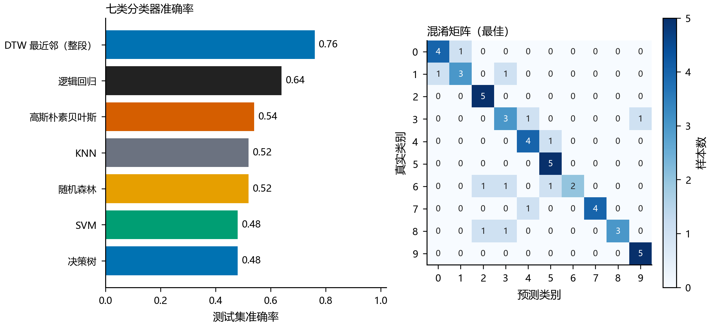

# 实验一 第三部分｜分类器选择与比较分析（交接说明）

- **负责人**：肖雨乐（按 I7/I8 裁决，分类器成果归本人）
- **协作**：梁博强（第一部分 数据与预处理）、师瑞颖（第二部分 时域特征）
- **周期**：第二周 10/12~10/18
- **本目录用途**：把第三部分的**结果、脚本、原始表格**打包给同组同学复核/引用，不依赖 `_交付` 或 `_env` 里的任何临时文件。

---

## 0. 一句话结论

在**同一固定划分**（每类 01–05 训练、06–10 测试，50/50）上比较 7 类分类器，**DTW 最近邻（整段波形）以 38/50 = 0.760 最优**，其余 6 个基于 16 维汇总特征的模型全部 ≤ 0.640；但训练集五折与测试集排序**倒挂**，说明 50 条训练样本撑不起 16 维特征，**这些数字只能作当前划分下的描述性比较，不可外推**。

---

## 1. 这一部分做了什么

| 环节 | 做法 | 对应文件 |
|---|---|---|
| 输入 | 复用第一部分 `processed/endpoint/` 与第二部分 16 维汇总特征，未重新提取特征 | `..\第一部分\第一部分\results\时域特征汇总.csv` |
| 划分 | 每类 01–05 训练（50 条）、06–10 测试（50 条），与 `run_week2.py` 完全一致，`seed=42` | 本目录脚本 `SEED` |
| 特征 | 每维 mean/std/max/q25/q75 × 5 维（log 能量、log 幅度、ZCR）+ 语音段时长 = 16 维 | 同上 |
| 模型 | 7 类：KNN、SVM、逻辑回归、高斯朴素贝叶斯、决策树、随机森林、DTW 最近邻 | `compare_7classifiers.py` |
| 选参 | 只在训练集上 `StratifiedKFold(5, shuffle=True, random_state=42)` + `GridSearchCV`；标准化封装在同一 Pipeline 内 | 同上 |
| 评价 | 测试集准确率、macro-F1、逐类召回、混淆矩阵、拟合/预测耗时 | `7类分类器比较.csv`、`7类分类器逐条预测.csv`、`7类分类器最佳混淆矩阵.csv` |

选参网格（全部在训练集内完成，测试集只在最后评一次）：

- KNN：`n_neighbors ∈ {1,3,5,7,9}` × `weights ∈ {uniform, distance}`
- SVM：`C ∈ {0.1,1,10,100}` × `kernel ∈ {linear, rbf}` × `gamma ∈ {scale,0.01,0.1,1}`
- 逻辑回归：`C ∈ {0.01,0.1,1,10,100}`
- 高斯朴素贝叶斯：`var_smoothing ∈ {1e-9,1e-8,1e-7}`
- 决策树 / 随机森林：`max_depth ∈ {None,3,5,7}`（森林为 `{None,5,10}`）× `min_samples_leaf ∈ {1,2}`，森林 `n_estimators=300`
- DTW：冻结件 `DTWClassifier(band_ratio=0.35)`，无参数搜索；输入为整段波形的 `[T,3]` 逐帧特征（`normalize=True`）

---

## 2. 结果

### 2.1 七类分类器总表

| 排名 | 分类器 | 正确/总数 | 准确率 | macro-F1 | 训练集五折 | 拟合 s | 预测 s |
|---|---|---|---|---|---|---|---|
| 1 | **DTW 最近邻（整段）** | **38/50** | **0.760** | 0.753 | — | 0.0000 | 15.9194 |
| 2 | 逻辑回归 | 32/50 | 0.640 | 0.632 | 0.640 | 0.3440 | 0.0004 |
| 3 | 高斯朴素贝叶斯 | 27/50 | 0.540 | 0.548 | 0.540 | 0.0324 | 0.0004 |
| 4 | KNN | 26/50 | 0.520 | 0.536 | 0.720 | 0.1883 | 0.0006 |
| 5 | 随机森林 | 26/50 | 0.520 | 0.477 | 0.680 | 7.8190 | 0.0082 |
| 6 | SVM | 24/50 | 0.480 | 0.500 | 0.740 | 0.3841 | 0.0005 |
| 7 | 决策树 | 24/50 | 0.480 | 0.451 | 0.580 | 0.0617 | 0.0001 |

选定参数：KNN `n_neighbors=3, weights=distance`；SVM `C=1, kernel=rbf, gamma=1`；逻辑回归 `C=100`；高斯 NB `var_smoothing=1e-9`；决策树 `max_depth=7`；随机森林 `max_depth=None, min_samples_leaf=1`；DTW `band_ratio=0.35`。

> 括号外的耗时只统计 `predict` 阶段，**不含**特征提取；DTW 的 15.9 s 是纯序列比对的代价，不是端到端基准。

### 2.2 逐类召回（7 个分类器 × 10 个数字）

| 分类器 | 0 | 1 | 2 | 3 | 4 | 5 | 6 | 7 | 8 | 9 |
|---|---|---|---|---|---|---|---|---|---|---|
| DTW 最近邻（整段） | 0.80 | 0.60 | **1.00** | 0.60 | 0.80 | **1.00** | 0.40 | 0.80 | 0.60 | **1.00** |
| 逻辑回归 | **1.00** | 0.40 | 0.40 | 0.40 | 0.40 | **1.00** | 0.40 | 0.60 | 0.80 | **1.00** |
| 高斯朴素贝叶斯 | 0.80 | 0.60 | 0.40 | 0.20 | 0.20 | 0.80 | 0.40 | 0.60 | 0.40 | **1.00** |
| KNN | 0.60 | 0.20 | 0.20 | 0.40 | 0.20 | 0.80 | 0.40 | 0.60 | 0.80 | **1.00** |
| 随机森林 | 0.80 | **0.00** | **0.00** | 0.40 | 0.20 | **1.00** | 0.40 | 0.60 | 0.80 | **1.00** |
| SVM | 0.60 | 0.20 | 0.20 | 0.40 | 0.40 | 0.60 | 0.40 | 0.40 | 0.80 | 0.80 |
| 决策树 | 0.80 | **0.00** | **0.00** | 0.20 | 0.20 | **1.00** | 0.40 | 0.60 | 0.60 | **1.00** |

每类测试样本数均为 5 条，因此召回率的粒度就是 0.20。

### 2.3 最主要的混淆对（7 个分类器合计）

| 真实 → 预测 | 次数 |
|---|---|
| 7 → 6 | 11 |
| 1 → 6 | 10 |
| 1 → 5 | 8 |
| 2 → 0 | 7 |
| 6 → 3 | 7 |
| 8 → 3 | 6 |
| 2 → 8 | 6 |
| 0 → 1 | 6 |

**类 6 是"吸收器"**：7 个分类器对类 6 的召回**全部是 0.40**，同时还吸走了大量 1 和 7。这不是某个模型的问题，更像这一类的录音/端点结果本身与邻近类混叠。

### 2.4 与第一部分四流程的关系

`分类器比较_第一部分四流程.csv` 是主流程 `run_week2.py --full` 的原始结果，口径与本表一致：

| 流程 | 正确/总数 | 准确率 | macro-F1 |
|---|---|---|---|
| KNN | 26/50 | 0.520 | 0.536 |
| SVM | 24/50 | 0.480 | 0.500 |
| DTW（端点段） | 27/50 | 0.540 | 0.539 |
| DTW（整段基线） | 38/50 | 0.760 | 0.753 |

本次第三部分的 7 类比较中，KNN / SVM / DTW（整段）三行与上表**逐位一致**（38/50 由两条独立链路分别算出），可作为交叉验证。



---

## 3. 三条值得写进报告的观察

1. **五折与测试集排序倒挂**。SVM 五折 0.740 最高、测试集只有 0.480；随机森林五折 0.680、测试集 0.520。50 条训练样本 + 16 维特征，交叉验证分数已经不能预测泛化 —— 这是过拟合的直接证据，比单看准确率更有信息量。
2. **低容量模型反而更稳**。逻辑回归（线性、5 个超参里只调 C）拿到 0.640，高于 RBF-SVM 的 0.480，也高于随机森林的 0.520。这个数据量下"更强"的模型没有优势。
3. **DTW 的优势与代价**。整段 DTW 保留帧序和首尾背景，0.760；一旦换成交付的端点段（`DTW_endpoint`）就掉到 0.540 —— 说明当前的自动裁剪在丢掉判别信息。代价是预测 15.9 s vs 亚毫秒，差 4 个数量级。

---

## 4. 口径与局限（引用这些数字时必须一起说）

1. **描述性比较，不作显著性结论**。测试集只有 50 条，且被 7 个分类器共同使用；应视为观察，不做统计检验，也不据此反向调参。
2. **存在数据泄漏风险**。划分按文件名序号固定（01–05 / 06–10），100 条录音来自同一说话人，同一说话人可能同时出现在训练与测试集 → 准确率偏乐观，**不能外推为跨说话人性能**。
3. **16 维汇总丢失帧序**。DTW 与其余 6 类的差异应解释为"是否保留时间顺序 + 绝对尺度"，不是"谁更先进"。另外 16 维聚合本身超出 PDF 要求，只作备注，不进正文。

---

## 5. 如何复现

环境（本次实测版本）：

```
Python 3.12.14 / numpy 2.3.5 / pandas 2.3.3 / scipy 1.16.3
scikit-learn 1.7.2 / matplotlib 3.10.6 / seaborn 0.13.2
```

依赖不在项目里，装在同组共享的 `..\_env\pylibs`：

```powershell
$py = "C:\Users\jinan2an\.dsh\dsh-runtimes\dsh-primary-runtime\dependencies\python\python.exe"
$env:PYTHONPATH = "..\_env\pylibs"
$env:MPLBACKEND = "Agg"
$env:MPLCONFIGDIR = "..\_env\mplconfig"
& $py .\compare_7classifiers.py
```

脚本会**就地覆盖**本目录的 3 个 CSV 与 `figures\` 两张图，耗时约 30 s（其中 DTW 预测占 16 s）。若只想看结果，直接读 CSV 即可，不必重跑。

前置条件：`..\第一部分\第一部分\results\时域特征汇总.csv` 存在（由 `run_week2.py --full` 生成）。该表含三种窗各 100 行共 300 行，脚本按 `window == "hamming"` 取 100 行。

---

## 6. 本目录清单

| 文件 | 说明 |
|---|---|
| `说明.md` | 本文件，交接说明 |
| `compare_7classifiers.py` | 生成全部结果的脚本（含选参网格与绘图） |
| `7类分类器比较.csv` | 7 行主表：准确率、macro-F1、五折、耗时、选定参数 |
| `7类分类器比较.md` | 同一批数字的 Markdown 版（脚本自动生成，含逐类召回与结论口径，可直接粘进报告） |
| `7类分类器逐条预测.csv` | 350 行 = 7 × 50，每行 `file/true/pred/classifier` |
| `7类分类器最佳混淆矩阵.csv` | 最佳分类器（DTW 整段）的 10×10 混淆矩阵 |
| `分类器比较_第一部分四流程.csv` | 主流程原始四流程结果，用于交叉核对 |
| `figures\q3_7class_comparison.png/.svg` | 准确率条形图 + 最佳混淆矩阵 |

---

## 7. 交接注意事项

1. **别把 0.760 当"识别率"**。它是 50 条测试样本上的描述性准确率，说话人未分离，见第 4 节。
2. **第三部分的成果不依赖 `wav_parse.py`**。它的奇数块修复（`task1_w1\wav_parse\wav_parse.py:33`）至今未同步，但本链路走的是冻结件 `read_wav`，不受影响。
3. **本目录与主流程解耦**。7 类比较目前是独立脚本，未并入 `run_week2.py`；若要把 7 类写进正式产物，需要改动主流程，得先组内确认。
4. **特征表与端点表的两处口径差异**：第一部分 `DTW_endpoint` 用的片段比第二部分计算特征用的片段右侧多 25 ms（`speech_time_domain.py:221` 补 `frame_len`，`feature_extract.py:152-154` 不补）。本次 7 类比较用的是第二部分口径的 16 维特征 + 整段 DTW，未混用两者。
5. 有任何数字对不上，先查 `7类分类器逐条预测.csv` 的逐条记录，再查本说明 —— 脚本可 30 s 重跑复现。
